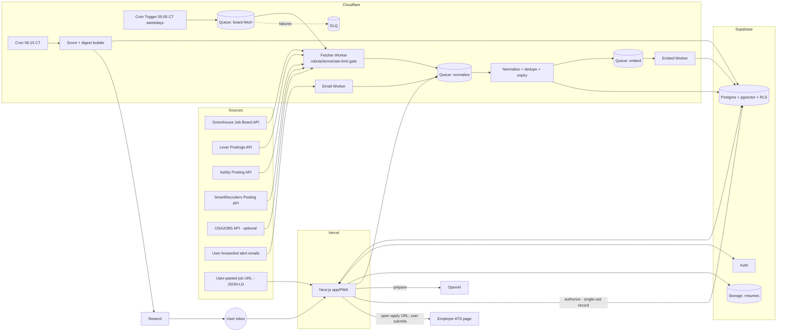

# 05 — Recommended MVP architecture

## Components
| Component | Tech | Responsibility |
|---|---|---|
| Web app + API | Next.js (App Router) on **Vercel Pro** | Onboarding, review queue, job detail, tracker, settings. Server actions for user mutations. Vercel Hobby is "non-commercial, personal use only", so use Pro once Jobr is a product [DL P3] |
| Data + auth | **Supabase Pro**: Postgres, Auth, RLS, Storage, pgvector, pg_cron | System of record, tenant isolation, resumes (private bucket), embeddings [VF P5, P9] |
| Ingestion / scoring / digest workers | **Cloudflare Workers**: Cron Triggers + Queues (+ DLQ). Workflows optional | Fan-out per board, fetch, normalize, dedupe, embed, score, build digests. ≤15 min CPU per Cron Trigger, ≤5 min CPU per invocation, $5/mo base [VF P12, P13] |
| Inbound email | Cloudflare **Email Worker** on `in.<domain>`, catch-all | Per-user alias receives forwarded alerts. Parse, then enqueue [VF P15] |
| Outbound email | **Resend** | Weekday digests, verification. Free tier caps at 100/day [VF P17] |
| AI | OpenAI `text-embedding-3-small` (1536-d). `gpt-5-mini` for extraction/explanations/drafts | Embeddings $0.02/1M. gpt-5-mini $0.25/$2.00 per 1M in/out [VF P16] |
| Observability | Supabase logs, Workers logs, `source_runs`/`digest_runs` tables, heartbeat alert | Scheduler reliability (V8) [EI] |

## Diagram

## Data flow (weekday)
1. **05:00 CT**: Cron Trigger enqueues one message per active board (`company_boards`). Fetcher workers check `source_policy` (allow-listed type, terms reviewed), the robots cache (24 h, per RFC 9309 [VF S18]), and the per-host token bucket, then call the API.
2. Fetched payloads go to `job_source_snapshots` (raw, 30-day TTL) and then to the normalize queue. Normalization maps the source to a canonical record, computes `content_hash` and the dedupe key, upserts `jobs` + `job_sources`, and marks jobs missing for 2 consecutive successful runs as `closed`.
3. New or changed jobs → embed queue → `job_embeddings`. LLM structured extraction (seniority, comp, remote policy, requirements) runs only on new or changed content [EI].
4. **06:15 CT**: scorer runs per user: hard filters (SQL) → lexical + vector candidates → weighted score → `matches`, with explanation for the top N. The digest builder writes `digests`/`digest_items` and sends via Resend at **07:00 CT** in the user's timezone.
5. During the day: user reviews in the app, shortlists, clicks **Prepare** (LLM drafts an answers/cover-letter package) → **Authorize** (explicit click creates a single-use `submission_authorizations` row bound to the package hash) → Jobr opens the employer apply URL → user submits there → Jobr records `submitted_unverified` and flips it to `submitted_confirmed` when a confirmation email arrives at the alias or the user attests.

## Deployment topology
- Two Supabase projects (dev, prod). Vercel preview per PR against dev. Wrangler `env.dev` / `env.prod`. One GitHub repo (monorepo: `apps/web`, `workers/ingest`, `packages/core`, `supabase/migrations`) with `AGENTS.md` at the root (file 09) [EI].
- Workers reach Supabase through the REST API (supabase-js with service role) for MVP simplicity. Hyperdrive or direct Postgres is a later optimization (needs verification) [AV].

## Background ingestion: Vercel vs alternatives
| Option | Verified limits/pricing | Fit for Jobr |
|---|---|---|
| **Vercel Cron + Functions** | Hobby: once/day, ±59 min precision, non-commercial. Pro: per-minute. Function max 300 s (Hobby) / 800 s (Pro) [VF P1–P3] | OK as a *trigger*. Poor as the batch engine (duration caps, no native queue). Use only for app API |
| **Supabase Cron (pg_cron) + Queues (pgmq) + Edge Functions** | ≤8 concurrent jobs, ≤10 min each recommended. pgmq exactly-once within a visibility window. Edge Functions 400 s wall / **2 s CPU** [VF P6–P8] | Fewest vendors. The 2 s CPU limit is risky for parsing 5,000-posting boards (e.g., SmartRecruiters BoschGroup) and HTML normalization [EI]. Good fallback, and good for DB-internal jobs (retention purges) |
| **Inngest** | Free 50k executions/mo. Pro from $99/mo [VF P10] | Great DX for durable steps. Costs more at scale. Adds a vendor |
| **Trigger.dev** | Free $5 credit, 10 schedules. Hobby $10. Pro $50 [VF P11] | Good long-running tasks. Adds a vendor. A strong alternative if Kwaku drops Cloudflare |
| **Cloudflare Workers Cron + Queues (+ Workflows)** | $5/mo base. Queues 1M ops included, then $0.40/M. Retention ≤14 days. DLQ. 15 min CPU per cron. Workflows step billing since 2026-08-10, 500k steps included [VF P12–P14] | **Recommended.** Cheapest at scale, Kwaku already uses Workers, per-board fan-out fits Queues, and inbound email lives on the same platform [EI] |

**Decision [EI]:** Cloudflare Workers + Queues for ingestion, scoring and digests. Supabase pg_cron only for in-database maintenance (retention, ghosting rules). Vercel for UI/API. Revisit Trigger.dev if Workers' runtime constraints (no Node-native libs for some parsers) bite [AV].
