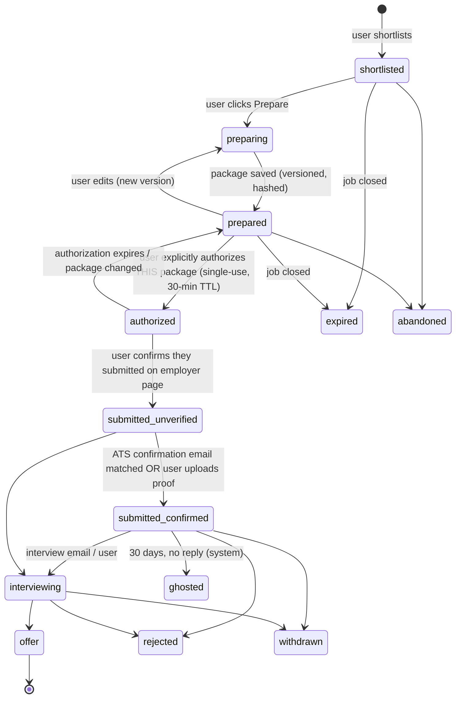

# 08 — Product / UX spec

## Onboarding journey (target ≤ 8 minutes)
1. **Sign in** with Supabase Auth (email magic link or Google OAuth with basic profile scope only, no Gmail scopes).
2. **Upload resume** (PDF/DOCX) → parse → show the extracted title history and skills for confirmation.
3. **Targets:** pick title families (chips, seeded from the resume), seniority, locations (DFW radius slider + "Remote US"), min base, employment types.
4. **Exclusions:** paste or import a blacklist and "do not reapply" list. For Kwaku, import from the Google Sheet tracker (CSV upload or Drive picker): Company, Role, Status, Do-not-reapply → `applications` (`imported_from='google_sheet'`) + `exclusion_rules`.
5. **Companies:** suggested boards (from the tracker and the shared registry) + "add careers URL". Jobr validates each against the ATS API.
6. **Email lane (optional):** show the personal alias and step-by-step forwarding-filter instructions for Gmail and Outlook. Jobr captures the provider's forwarding-verification email at the alias and shows the code in-app [AV: provider flow].
7. **Digest:** time (default 07:00 CT), weekdays. Send a sample digest now.

## Screens
| Screen | Purpose | Key elements |
|---|---|---|
| **Today** (default, mobile-first) | The daily review ritual | Ranked cards: title, company, location/remote, pay, score bucket, 3 "why" bullets, freshness ("first seen 2 d ago · ATS-direct"). Actions: Shortlist, Hide (reason chips), Open |
| **Job detail** | Decide | Component score bars, evidence quotes, full JD, source provenance (ATS, first/last seen), duplicate/repost notice, "Prepare application" |
| **Prepare** | Build the package | Resume version, draft answers to the job's questions (Greenhouse `questions` when available [VF S1]), cover-letter draft, editable. Demographic/EEO questions are never auto-answered. "Save package" → state `prepared` |
| **Authorize & go** | Explicit consent | Summary of exactly what will be used (package hash short-code). Checkbox "I am submitting this application myself on <employer site>". Button **Authorize & open employer page** → creates the single-use authorization and opens the `apply_url` |
| **Did you submit?** | Truthful status | Shown on return or via digest: "Yes, I submitted" (→ `submitted_unverified`), "Not yet", "Couldn't". Auto-upgrades to `submitted_confirmed` when an ATS confirmation email hits the alias |
| **Tracker** | Pipeline | Kanban/table by state. Filters. Ghosted auto-rule (30 days with only a confirmation, matching Jobber's definition). Export CSV / sync to Google Sheet (Phase 6) |
| **Companies** | Coverage | Followed boards, status (active/invalid/blocked), last run, jobs open |
| **Settings** | Control | Preferences, exclusions, alias, digest schedule, data export, delete account |
| **Digest email** | Push surface | Top 5–10 "Strong"/"Worth a look", each with a deep link to Job detail. Footer: run health ("312 companies checked at 05:04 CT") |

## Application state machine (prepare ≠ authorize ≠ submit)

**Invariants (enforced in DB RPCs, tested in file 14):**
1. `→ authorized` only from `prepared`, only by the owning user's session, and only with a fresh `package_hash` match.
2. `→ submitted_*` requires a consumed authorization for that application. Jobr has **no code path that submits a form or POSTs to an ATS on the user's behalf** in Phases 1–6.
3. The system may only move states toward *less* certainty (expired, ghosted) or upgrade with evidence (`submitted_confirmed` requires a matched email or a user attestation, stored in `application_events.evidence`).
4. Any package edit invalidates outstanding authorizations.

## Mobile
PWA (installable), with the Today and Job detail screens designed at 375 px first. Tap targets ≥ 44 px. The digest email renders in Gmail/Outlook mobile. Native app is deferred.
