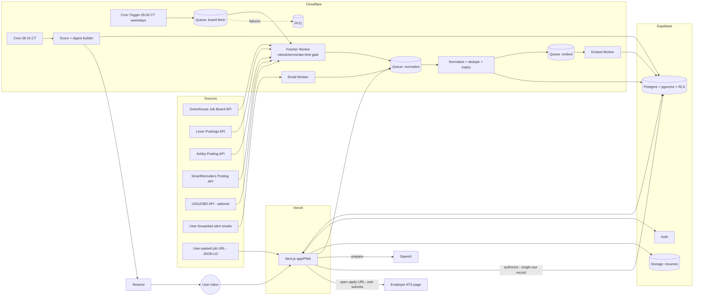
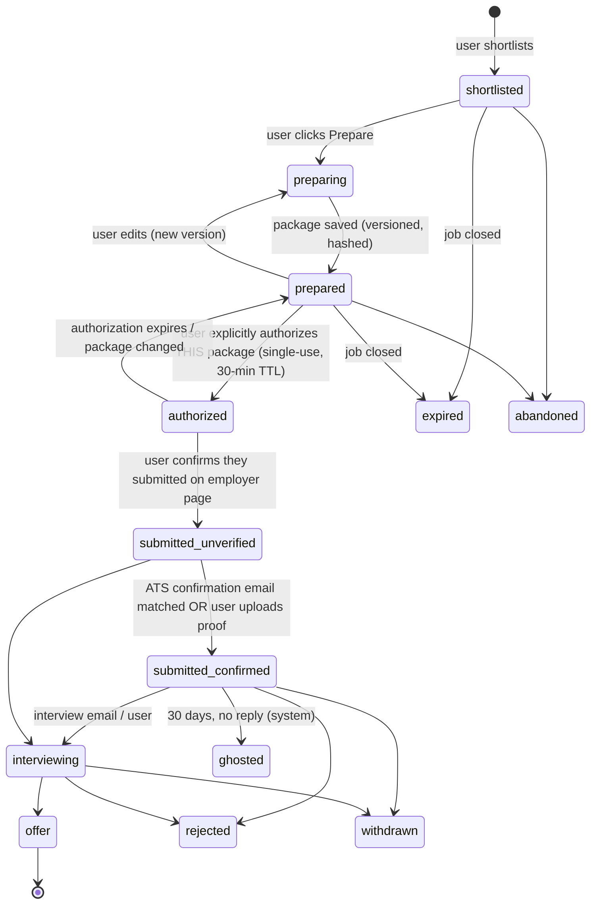

# Jobr — Phase 0 Engineering Blueprint

**Prepared for:** Kwaku (Kevin) Obeng · **Prepared by:** Grok Bot · **Date:** Wednesday, Oct 14, 2026 (CT)
**Scope:** AI job discovery, matching, approval, application tracking and daily digest SaaS. It productizes Kwaku's existing "Jobber" agent workflow. No codebase is included.

**Claim labels:** [VF] Verified fact · [DL] Documented limitation · [EI] Engineering inference · [AV] Assumption to validate · UNCONFIRMED. Source IDs (S#, P#, C#, T#) are listed in the final section, *Evidence legend and source register*. All sources were accessed 2026-10-14.

**Non-negotiables honored throughout:** every application needs explicit per-submission human authorization. No terms-violating scraping. No CAPTCHA or anti-bot circumvention.

## Contents
- 01 — Executive assessment
- 02 — Expert gap analysis (7 perspectives)
- 03 — Job acquisition: primary-source research and feasibility
- 04 — Competitive analysis (from vendors' own pages, accessed 2026-10-14)
- 05 — Recommended MVP architecture
- 06 — Matching engine spec
- 07 — Database schema (Postgres / Supabase, DDL-level spec)
- 08 — Product / UX spec
- 09 — Multi-agent execution plan
- 10 — Roadmap, Phases 0–7
- 11 — Cost model (1 / 100 / 1k / 10k users)
- 12 — Risk register
- 13 — Codex backlog (small, testable tasks)
- 14 — Independent validation framework (Section 2D items)
- 15 — Immediate next actions and first demoable milestone
- 16 — Unverified items (do not build on these until resolved)
- 00 — Evidence legend and source register

---

## 01 — Executive assessment

**Verdict: feasible, if Jobr is built as an "ATS-first discovery + human-gated application copilot". It is not feasible as a "scrape everything and auto-apply" product.**

1. **Job acquisition is the critical dependency, and the core of it is solved for free.** Greenhouse, Lever, Ashby and SmartRecruiters all publish unauthenticated JSON posting endpoints meant for careers pages [VF S1–S5]. Each returns titles, descriptions, locations, often pay, and a canonical apply URL. They cover the startup/tech/SaaS segment where most of Kwaku's Account Executive and RevOps targets post (his tracker sources show Greenhouse, Lever, Ashby, iCIMS, Workday) [EI from tracker]. The catch is that these APIs work **per company** (board token or site name), not as a search engine. Jobr therefore needs a **company registry** and a discovery loop, and that is the real engineering work [EI].
2. **The big boards are off-limits as sources.** LinkedIn prohibits scraping and bots and is not taking new Job Posting API partners. Its API also points the other way (ATS → LinkedIn) [DL S8, S9]. Indeed's terms (updated 2026-09-29) ban bots, scrapers and "AI or Agentic AI" without written permission [DL S10]. ZipRecruiter's terms are behind a bot challenge, so they are UNCONFIRMED and get no design dependency [S12]. Workday has no public cross-tenant jobs API. The careers-site JSON is undocumented [DL S6, EI].
3. **Automated submission is not available to us via ATS APIs.** The Greenhouse and Lever application POSTs require the *employer's* secret key [VF S1, S2]. That matches the non-negotiable anyway: every submission needs explicit human authorization. Jobr **prepares** an application package. The user **authorizes** it, then completes the submit on the employer's page. Jobr records the submission as *unverified* until evidence arrives, such as a confirmation email or a user attestation with a timestamp [EI].
4. **Jobber's email lane carries over cleanly without Gmail restricted scopes.** `gmail.readonly` is a restricted scope, so a public app would need an annual CASA security assessment [DL P18, P19]. Instead, each user gets a forwarding alias (`u-<id>@in.<domain>`) handled by a Cloudflare Email Worker [VF P15]. HiringCafe and other alert emails feed in that way, with no inbox OAuth [EI].
5. **Recommended stack:** Next.js (Vercel) for UI/API, Supabase (Postgres + Auth + RLS + pgvector + Storage), Cloudflare Workers (Cron Triggers + Queues) for ingestion, scoring and digests, OpenAI for embeddings (`text-embedding-3-small`, $0.02/1M tokens) plus small-model extraction and explanations, and Resend for digests [VF P4, P5, P12, P16, P17]. Kwaku already runs Cloudflare Workers, and Workers avoid Vercel's 300/800 s function cap and Supabase Edge's 2 s CPU cap for batch work [VF P2, P8].
6. **Cost is low.** About $33/mo for Kwaku alone. About $0.27 per user per month at 10k users ($0.37 with a licensed aggregator) [EI, file 11]. Ingestion cost scales with the size of the shared job corpus, not with user count.
7. **Smallest real-user MVP (Phases 1–5):** Kwaku only. About 150–300 target companies on the four public ATS APIs, plus his forwarded alert emails. Hard filters, then hybrid ranking. A weekday 7:00 CT digest. An approval queue and a tracker imported from his Google Sheet, with the prepare/authorize split. **First demoable milestone (M1):** a live, scheduled ingestion of ≥100 real companies into Supabase, with dedupe, expiry, and a ranked list for Kwaku's profile that has zero exclusion violations against his blacklist and "do not reapply" list (file 15).
8. **Top risks:**
   - Coverage gaps: Workday/iCIMS-heavy enterprises, and anything only on LinkedIn or Indeed.
   - Board-token discovery effort.
   - ATS endpoint changes.
   - Matching quality on his sales/RevOps profile.
   - Agent capacity: Cursor cloud usage gets exhausted, and Codex Web has an open "project root" defect [VF T1].
9. **Context to validate [AV]:** Kwaku accepted an offer starting 2026-11-10 (tracker). His own job-search use may taper, so decide whether the MVP's real user is Kwaku (dogfood) or a small external cohort.

**Decisions Kwaku must make now:** see the "Decide now" table in file 02 and file 15.

---

## 02 — Expert gap analysis (7 perspectives)

The reference workflow (Jobber) is a weekday agent that reads Gmail job emails and a saved HiringCafe search, flags blacklisted and already-applied companies, and writes to a Google Sheet. Productizing it exposes the gaps below.

### Architect
| Gap | Why it matters | Resolution |
|---|---|---|
| No canonical job identity across sources | The same role shows up in a HiringCafe email, on Greenhouse, and in an aggregator | `jobs` canonical row + `job_sources` many-to-one. Key = (ATS, board, external_id), with a fuzzy fallback on (company, normalized title, location) [EI] |
| Company-scoped ATS APIs | No search endpoint exists. You must know each board token [VF S1–S4] | `companies` + `company_boards` registry, seeded from the tracker, alert emails and user-pasted URLs [EI] |
| Long batch jobs vs serverless caps | Vercel caps at 300 s (Hobby) / 800 s (Pro). Supabase Edge allows 2 s CPU [DL P2, P8] | Fan out one queue message per board on Cloudflare Queues [VF P13] |
| Agent-shaped logic in a SaaS | Jobber logic lives in prompts | Deterministic pipeline. LLMs only for extraction, explanations and drafting, behind schemas [EI] |

### ML / ranking
| Gap | Resolution |
|---|---|
| No labelled data | Bootstrap from the tracker's 141 outcomes (Applied/Interviewing/Offer as positives, Blacklisted/"Do not reapply" as hard negatives) plus 300 hand-labelled jobs [AV: labels usable] |
| Opaque LLM scoring | Weighted, component-level score. The LLM writes the explanation, never the score (file 06) [EI] |
| pgvector + filters return short lists | Documented by Supabase [DL P9]. Use exact cosine over the hard-filtered candidate set (small per user), no ANN index in the MVP [EI] |
| Postgres FTS ≠ BM25 | `ts_rank_cd` is not BM25 [EI]. BM25 extension availability on Supabase is UNCONFIRMED, so ship FTS-ranked lexical scoring first and benchmark |

### Recruiting tech
| Gap | Resolution |
|---|---|
| Expiry detection | Jobs vanish from board JSON when closed. Mark `closed_at` after 2 consecutive misses. Honour `validThrough` from JSON-LD [VF S7, EI] |
| Reposts and evergreen reqs | Track `first_seen_at`, repost lineage, and Greenhouse `first_published` / Ashby `publishedAt` [VF S1, S3] |
| Duplicate applications | DB-level uniqueness per (user, job) and per (user, company, title family) within 90 days, plus "do not reapply" (file 07) |
| Application forms vary per job | Greenhouse exposes per-job `questions` and compliance/EEOC/demographic questions [VF S1]. Use them to *prepare* answers. Demographic answers stay user-entered only |

### Security
| Gap | Resolution |
|---|---|
| Resume and PII in a multi-tenant DB | Supabase RLS on every user table, private Storage bucket, signed URLs, column-level care for phone and address [EI] |
| Inbox access | Avoid Gmail restricted scopes (CASA) [DL P19]. Use the forwarding alias. Sanitize inbound HTML. Treat email content as untrusted (prompt-injection boundary) |
| Unauthorized submission | Submission requires a single-use, short-TTL authorization record bound to a hash of the exact package. No code path submits without it (file 08, test V6) |
| Secrets | Service-role key only in Workers/server. Never in the client. Rotate quarterly [EI] |

### PM
| Gap | Resolution |
|---|---|
| Unclear wedge vs. Simplify/Jobright | Wedge: trustworthy curation. Genuine, fresh, ATS-direct listings, explainable ranking, zero-exclusion guarantee, and honest status (file 04) [EI] |
| Single-user origin | Phase the product: dogfood with Kwaku (M1–M3), then a 10–20 user cohort, then self-serve [AV] |
| Pricing undecided | Defer until the cohort's retention data exists. Competitors sit at $29–40/mo [VF C1, C3, C4] |

### DevOps
| Gap | Resolution |
|---|---|
| Scheduler reliability is unobservable today | `source_runs` + `digest_runs` tables, heartbeat alert if no successful run in 26 h, dead-letter queue [VF P13 DLQ] |
| Agent tooling instability | Repo root with `AGENTS.md`, single package root, CI as the source of truth. Codex Web project-root bug workaround in file 09 [VF T1] |
| Environments | Supabase dev + prod projects. Vercel preview deploys. Wrangler environments [EI] |

### QA
| Gap | Resolution |
|---|---|
| No golden data | Recorded ATS fixtures (JSON snapshots), golden ranking set, seeded RLS test users |
| Hard guarantees untested | Property tests for exclusion = 0, authorization gating, uniqueness. Contract tests per connector. Tenant-isolation tests with two JWTs (file 14) |

### Decide now vs. defer
| Decide now (blocks Phase 1–2) | Recommended | Defer (no blocker before Phase 6+) |
|---|---|---|
| Job-source policy: official public APIs + user-forwarded email + user-pasted URLs only. No LinkedIn/Indeed/ZipRecruiter scraping, no Workday internal JSON | Yes | Licensed aggregator (Coresignal/Adzuna commercial) |
| Submission model: prepare → authorize → user submits on the employer page | Yes | Browser extension for assisted autofill |
| Stack: Next.js/Vercel + Supabase + Cloudflare Workers | Yes | Moving UI to Cloudflare (OpenNext) |
| Email lane via forwarding alias (no Gmail OAuth) | Yes | Gmail/Outlook OAuth (CASA cost) |
| Domain name for inbound mail and the app | Kwaku picks | Billing/Stripe, pricing |
| Embedding model + dimension (1536, text-embedding-3-small) | Yes (changing later means a re-embed) | BM25 extension, learned-to-rank |
| First user = Kwaku. Tracker import from his Sheet | Yes | Mobile native app (ship PWA first) |

---

## 03 — Job acquisition: primary-source research and feasibility

Labels: [VF] verified · [DL] documented limitation · [EI] inference · [AV] assumption · UNCONFIRMED. Source IDs refer to file 00. All sources were accessed 2026-10-14.

### 1. Per-source findings

#### Greenhouse Job Board API (S1, S5)
- [VF] `GET https://boards-api.greenhouse.io/v1/boards/{board_token}/jobs[?content=true]` and `/jobs/{id}?questions=true&pay_transparency=true`. "Job Board data is publicly available, so authentication is not required for any GET endpoints."
- [VF] Fields: `id`, `internal_job_id`, `title`, `updated_at`, `first_published`, `application_deadline`, `requisition_id`, `location.name`, `absolute_url`, `content` (HTML-entity-encoded), `departments`, `offices`, `metadata`, `pay_input_ranges` (min/max cents, currency), plus per-job `questions`, `location_questions`, `compliance`, `demographic_questions`, `data_compliance`.
- [DL] Submitting needs `POST .../jobs/{id}` with HTTP Basic auth using the **employer's** Job Board API key. The docs warn that the key is a secret and that posts must be proxied by the employer's servers. Greenhouse "will not reject applications that are missing required fields" and recommends its embedded form, which has spam protection.
- [DL] The docs publish no rate limit for GETs → UNCONFIRMED. The docs publish no terms for third-party aggregation → UNCONFIRMED (the stated purpose is building your own careers page).
- [EI] Submission by Jobr is **not possible** without employer credentials. Jobr links out to `absolute_url`.

#### Lever Postings API (S2, S5)
- [VF] `GET https://api.lever.co/v0/postings/{site}?mode=json&skip=&limit=` (EU: `api.eu.lever.co`). Filters: location, commitment, team, department, level, group.
- [VF] Fields include `id`, `text`, `categories` (location, commitment, team, department, allLocations), `description`/`lists`, `hostedUrl`, `applyUrl`, `workplaceType` (on-site/remote/hybrid/unspecified), and optional `salaryRange` (currency, interval, min, max).
- [DL] Apply needs `POST /v0/postings/SITE/POSTING-ID?key=APIKEY`. The key is generated by the customer's Super Admin. Lever returns 429 above **2 application POSTs/second** and says this "may also be changed without warning".
- [VF] `jobs.lever.co/robots.txt`: `Allow: /`, `Crawl-delay: 1`. [EI] Respect 1 req/s per host for any HTML fetch. Use the API for data.

#### Ashby public Job Postings API (S3, S5)
- [VF] `GET https://api.ashbyhq.com/posting-api/job-board/{JOB_BOARD_NAME}?includeCompensation=true`. No auth is shown in the docs. The live probe returned 200.
- [VF] Fields: title, location, secondaryLocations, department, team, isListed, isRemote, workplaceType, descriptionHtml/Plain, publishedAt, employmentType, address, `jobUrl`, `applyUrl`, and compensation tiers with min/max/currency/interval.
- [DL] This API has no application endpoint. [DL] `jobs.ashbyhq.com/robots.txt` disallows `/api/` (that is the jobs-site host, not `api.ashbyhq.com`). Ashby's application-submit API: UNCONFIRMED (not verified).
- [DL] `isListed=false` jobs should be "only available via direct link". [EI] Jobr must not surface unlisted jobs in discovery.

#### SmartRecruiters Posting API (S4, S5)
- [VF] `GET https://api.smartrecruiters.com/v1/companies/{companyIdentifier}/postings` and `/postings/{id}`. "The internal_postings_read OAuth scope is only required when the destination query parameter is INTERNAL or INTERNAL_OR_PUBLIC." The live probe on `BoschGroup` returned `totalFound: 5033` with no auth.
- [DL] Rate limits: "most endpoints … up to 10 requests per second" and 8 concurrent.
- [VF] An Application API exists (customer and Marketplace/partner variants: screening questions, post application, candidate status). [DL] It requires customer or partner credentials. [EI] Not usable by a job-seeker app without a partnership.

#### Workday (S6, S19)
- [VF] The official Recruiting web service is **tenant-scoped** (e.g., `Get_Job_Postings`, `Post_Job` to "a career site configured in a tenant"). I found no public, documented, cross-tenant jobs API on Workday's own sites → **"no public API" confirmed as far as primary docs show**.
- [EI] Secondary sources describe an undocumented `POST /wday/cxs/{tenant}/{site}/jobs` JSON endpoint behind myworkdayjobs.com pages (page size 20, total capped at 2,000). It is undocumented, has no stated terms, and can change without notice. **Excluded from the design.**
- [VF] Example tenant robots.txt (nvidia.wd5…) allows the external careers site path and publishes a sitemap. [EI] Only allowed path: a **user-initiated** single-URL fetch of a Workday job page to read schema.org `JobPosting` JSON-LD, if present (presence UNCONFIRMED per tenant), at human cadence.

#### Google JobPosting structured data (S7)
- [VF] Required properties: `title`, `description`, `datePosted`, `hiringOrganization`, `jobLocation` (or `applicantLocationRequirements` + `jobLocationType: TELECOMMUTE` for remote). Recommended: `baseSalary`, `employmentType`, `identifier`, `validThrough`, `directApply`.
- [VF] Expired jobs must have `validThrough` in the past, return 404/410, or drop the markup. "We don't allow expired job postings."
- [EI] This is the **universal parser** for user-pasted job URLs and for alert-email links that resolve to non-API ATSs (iCIMS, Workday, custom pages). It is also an expiry signal. Google does not expose a jobs search API here; this doc covers publisher markup only [VF].

#### LinkedIn (S8, S9)
- [DL] The User Agreement §8.2 forbids: software, scripts, robots, crawlers or browser plugins that "scrape or copy the Services"; bypassing access controls; and copying information obtained "directly or through third parties (such as search tools or data aggregators)".
- [DL] Job Posting API: "We are currently not accepting new partnerships." It is restricted to approved developers who sign an API agreement. Direction: post jobs **to** LinkedIn on behalf of ATS customers.
- [EI] **No LinkedIn source.** Users may paste a LinkedIn URL. Jobr then asks for the employer's own apply URL and does not fetch LinkedIn.

#### Indeed (S10, S11)
- [DL] Terms (Last Updated 2026-09-29): users may not "use any automated system (bots, scrapers, spiders, AI or Agentic AI) to access, data-mine, or submit content… without Indeed's express written permission". Crawling is permitted only per robots.txt, and there is no ML training. [VF] The developer portal requires login. Public read API: UNCONFIRMED.
- [EI] **No Indeed source.** Indeed job-alert emails a user forwards are *their* email. We parse only the employer name, title and link text, and we do **not** fetch indeed.com links automatically. Even that stance needs legal review [AV].

#### ZipRecruiter (S12)
- UNCONFIRMED. The terms page is behind a Cloudflare bot challenge, and I did not bypass it, on purpose. Treat it like Indeed: no source, no fetching.

#### Licensed and open aggregators
| Source | Verified | Limits / terms | Verdict |
|---|---|---|---|
| **USAJOBS** (S14) | [VF] API key auth. Search API: max 10,000 rows/query, 500/page. Public Data under an open license; commercial reuse allowed without prior approval | Federal jobs only | **Use** as an optional source (low relevance for Kwaku's sales roles) |
| **Adzuna** (S13) | [VF] Defaults 25/min, 250/day, 1000/week, 2500/month. Permissible use: publishing Adzuna listings, salary estimates, personal research. Other commercial use limited to a 14-day trial. Attribution label ≥116×23 px linking to Adzuna. Must not contact Adzuna's content providers | Needs a commercial agreement | **Defer**. Request terms and a quote [AV] |
| **The Muse** (S15) | [VF] 500 req/h unregistered, 3,600 req/h with key. Content must link back to themuse.com. No cloning of Muse content | Coverage skews to Muse clients | **Optional** low-cost supplement [AV coverage] |
| **Coresignal** (S16) | [VF] Self-serve: Mini $49/mo (2,000 credits) up to Elite $5,000/mo (10M). 1 credit per multi-source job posting. Growth $1,000/mo includes 20 req/s | Source provenance and redistribution rights UNCONFIRMED | **Defer** to Phase 7. Verify data provenance (do not inherit scraped-LinkedIn risk) [AV] |
| **TheirStack** (S17) | [VF] Company-credit packs $109 (1k) to $999 (200k) | Per-job API pricing and provenance UNCONFIRMED | Defer |
| **HiringCafe** (S19) | [VF] robots.txt disallows `/viewjob/`, `/org/`, `/company/`. Terms page returned 403 to my fetch → UNCONFIRMED | No API found | Use **only** via the user's own saved-search emails (Jobber's current lane). No crawling |

#### robots.txt (S18, S19)
- [VF] RFC 9309: the rules "are not a form of access authorization". Cache for no more than 24 h. On 5xx, assume complete disallow.
- [EI] Policy: robots.txt is **necessary, not sufficient**. Every fetch must pass (1) an allow-listed source type, (2) a terms check recorded in `sources.terms_reviewed_at`, (3) robots.txt, and (4) a per-host rate limit (≤1 req/s, or the site's Crawl-delay). We never fetch behind login, CAPTCHA or bot challenges. A challenge response (403 + challenge markers, or 429) means stop and mark the source `blocked`, with no retry evasion.

### 2. Feasibility matrix
| Source | Access | Auth | Terms for 3rd-party use | Rate limits | Cost | Freshness | Coverage (Kwaku's segment) | Key fields | Apply URL | Submit via API? | Maintenance |
|---|---|---|---|---|---|---|---|---|---|---|---|
| Greenhouse | Public JSON per board [VF] | None for GET [VF] | No aggregator terms found → UNCONFIRMED | Undocumented → UNCONFIRMED | $0 [VF] | Real-time on poll. `updated_at` [VF] | High for tech/SaaS [AV] | Title, HTML desc, location, offices, pay ranges, questions [VF] | `absolute_url` [VF] | **No**, employer key [DL] | Low. Stable v1 [EI] |
| Lever | Public JSON per site [VF] | None for GET [VF] | Not found → UNCONFIRMED | GET undocumented. Apply 2/s [DL] | $0 | Real-time on poll | Medium–high [AV] | Title, categories, workplaceType, salaryRange [VF] | `hostedUrl`/`applyUrl` [VF] | **No**, employer key [DL] | Low |
| Ashby | Public JSON per board [VF] | None [VF] | Not found → UNCONFIRMED | Undocumented | $0 | `publishedAt` [VF] | Growing in startups [AV] | Rich: comp tiers, workplaceType, address [VF] | `jobUrl`/`applyUrl` [VF] | **No** endpoint in this API [VF] | Low |
| SmartRecruiters | Public JSON per company [VF] | None for PUBLIC [VF] | Not found → UNCONFIRMED | 10 rps / 8 concurrent [DL] | $0 | Real-time | Enterprise/EU-heavy [AV] | Name, location, refNumber, jobAd sections [VF] | Posting URL [AV field name] | Partner/customer only [DL] | Low–med |
| Workday | No public cross-tenant API [VF S6] | Tenant OAuth [VF] | Undocumented internal JSON → **excluded** | n/a | n/a | n/a | High for enterprise. **Gap** | JSON-LD on job page: per-tenant UNCONFIRMED | Job page URL | No | High if attempted. **Don't** |
| JSON-LD on job pages (user-pasted / email links) | Per URL [VF S7] | None | Site terms vary. User-initiated only [EI] | Per-host ≤1 rps [EI] | $0 | At fetch time. `validThrough` [VF] | Any site with markup | Google-required props [VF] | Page URL | No | Medium (parser edge cases) |
| Forwarded alert emails (HiringCafe, ATS, boards) | User's own mail via alias [VF P15] | Alias secret | User's data. Do not auto-fetch LinkedIn/Indeed/ZipRecruiter links [EI] | n/a | ≈$0 (Workers) | Arrival time | Whatever Kwaku subscribes to | Title/company/link (varies) | Resolved link | No | Medium (template drift) |
| LinkedIn | **Prohibited** [DL S8] | Partner only, closed [DL S9] | No | — | — | — | — | — | — | — | — |
| Indeed | **Prohibited** without permission [DL S10] | Login portal [VF S11] | No | — | — | — | — | — | — | — | — |
| ZipRecruiter | UNCONFIRMED [S12] | UNCONFIRMED | Assume no | — | — | — | — | — | — | — | — |
| USAJOBS | Public API [VF] | API key [VF] | Open license, commercial OK [VF] | 10k rows/query, 500/page [DL] | $0 | Daily+ [AV] | Low for sales | Full announcement schema [VF] | Announcement URL | No | Low |
| Adzuna | API [VF] | app_id/app_key [VF] | Commercial beyond 14-day trial needs agreement [DL] | 25/min, 250/day… [DL] | Quote → UNCONFIRMED | Aggregated [AV] | Broad (aggregator) [AV] | Title, desc snippet, salary, redirect URL [AV] | Adzuna redirect [AV] | No | Low, but contract-bound |
| The Muse | API [VF] | Optional key [VF] | Link back required. No cloning [DL] | 500 or 3,600 req/h [DL] | $0 [AV] | Unknown | Narrow [AV] | Jobs + companies [VF] | Muse URL | No | Low |
| Coresignal | Paid API [VF] | Key | Provenance/redistribution UNCONFIRMED | Plan-based (e.g. 20 rps) [VF] | $49–$5,000/mo [VF] | UNCONFIRMED | Broad [AV] | Multi-source job record [VF] | UNCONFIRMED | No | Low tech, high legal diligence |

**Feasibility verdict [EI]:** an MVP is feasible on four public ATS APIs, forwarded email, and the user-pasted-URL JSON-LD parser, at $0 data cost. The remaining gap (Workday/iCIMS/Taleo enterprises, and LinkedIn-only roles) is closed by user-pasted URLs and forwarded alerts, and later by a licensed aggregator once provenance is verified.

### 3. Board-token discovery (the real work) [EI]
1. Seed from Kwaku's tracker "Source (ATS/channel)" column and companies, and from alert-email links (resolve SendGrid redirects with a single HEAD/GET, without rendering) → detect ATS host patterns (`boards.greenhouse.io/{token}`, `job-boards.greenhouse.io/{token}`, `jobs.lever.co/{site}`, `jobs.ashbyhq.com/{name}`, `jobs.smartrecruiters.com/{company}`).
2. Users add companies by careers URL. Jobr detects the ATS and validates it with one API call.
3. Validate: the board API returns 200 and the job count is ≥0. Re-validate weekly. Deactivate a board after 3 consecutive 404s.
4. A shared registry grows with every user (network effect). Target 300 boards in Phase 2 and 2,000 by Phase 7 [AV].

### 4. Section 16 questions, answered explicitly
> The brief's Section 16 text was not provided to me (MASTER-PROMPT.md is a stub). These questions are **reconstructed** from the deliverable list. Replace them if the originals differ.

1. **Can Jobr legally and technically acquire genuine listings without scraping?** Yes. It can use Greenhouse, Lever, Ashby and SmartRecruiters public posting APIs [VF S1–S5], USAJOBS [VF S14], user-forwarded email [VF P15], and user-pasted URLs parsed via JSON-LD [VF S7]. The ATSs publish no third-party usage terms (UNCONFIRMED), so get a light legal read before charging money [AV].
2. **Can we use LinkedIn, Indeed or ZipRecruiter data?** No. LinkedIn and Indeed prohibit it [DL S8, S10], and the LinkedIn partner API is closed and posting-direction only [DL S9]. ZipRecruiter is UNCONFIRMED, so we treat it as no.
3. **Does Workday have a public API?** Not for cross-tenant job reads. The official API is tenant-scoped [VF S6]. The internal careers JSON is undocumented and excluded [EI].
4. **Can Jobr submit applications automatically?** Not through these APIs: the submit endpoints need employer credentials [DL S1, S2, S4]. And by policy every submission requires explicit per-submission human authorization. Jobr prepares; the user authorizes and submits.
5. **How fresh can listings be?** As fresh as the poll interval. Plan for weekday polling of every board at 05:00 CT before a 07:00 digest, plus intra-day polls for starred companies [EI]. Expiry = absent from the board for 2 consecutive polls, or `validThrough` past [VF S7, EI].
6. **What coverage gap remains, and how is it closed?** Enterprise ATSs (Workday, iCIMS, Taleo) and board-exclusive postings. They are closed by forwarded alerts and pasted URLs now, and by a licensed aggregator later, after a provenance check [AV].
7. **What do licensed sources cost?** Coresignal $49–$5,000/mo [VF S16]. Adzuna commercial pricing is UNCONFIRMED (contact required) [DL S13]. USAJOBS and The Muse cost $0 [VF].
8. **How do we keep Jobber's email lane without Gmail restricted scopes?** Per-user forwarding alias into a Cloudflare Email Worker [VF P15]. This avoids `gmail.readonly` (restricted, needs CASA) [DL P18, P19].
9. **How is robots.txt handled?** RFC 9309-compliant parser, 24 h cache, 5xx means disallow [VF S18]. robots.txt never overrides site terms. No CAPTCHA or anti-bot circumvention, ever.
10. **What are the maintenance hotspots?** Email template drift, JSON-LD edge cases, and board-token churn. ATS API shape changes are low risk but get contract tests (file 14).

---

## 04 — Competitive analysis (from vendors' own pages, accessed 2026-10-14)

| Product | Discovery | Matching | Apply model | Tracker | Price (own page) | Evidence |
|---|---|---|---|---|---|---|
| **Simplify** | Personalized job recommendations from user dealbreakers [VF C2] | Keyword score + missing keywords (free). Tailoring in Simplify+ [VF C1] | **Copilot browser extension autofills** on "100,000+ company career sites". The user clicks submit [VF C2] | Yes, free [VF C2] | Copilot free. Simplify+ **$19.99/wk, $39.99/mo, $89.99/3 mo** [VF C1] | C1, C2 |
| **Teal** | Job board + bookmarking [VF C3] | Resume ↔ JD match score [VF C3] | Autofill feature [VF C3] | Unlimited job tracking (free) [VF C3] | Free. Teal+ **$13/7 days, $29/30 days, $79/90 days** [VF C3] | C3 |
| **Huntr** | Basic job matching (free) [VF C4] | Basic resume scoring (free). AI tailoring (Pro) [VF C4] | Unlimited application autofills via Chrome extension [VF C4] | Job, contact and interview trackers [VF C4] | Free. Pro **$40/mo, $90/3 mo, $160/6 mo** [VF C4] | C4 |
| **LoopCV** | "Scans 30+ job boards daily" [VF C5] | Matches roles to the CV [VF C5] | **Auto-apply: "submits applications on your behalf automatically"** [VF C5] | Yes [VF C5] | Free. Paid **from €9.99/mo** [VF C5] | C5 |
| **Jobright** | Own blog claims "400K new jobs/day" [VF C6, claim not audited] | AI matching + Orion assistant [VF C6] | Autofill extension (blog) [VF C6] | Yes (blog) [VF C6] | Blog states **Free / $29.99/mo**. The same post also says $19.99, and another post says $30. **No official pricing page found (404) → current price UNCONFIRMED** | C6 |
| **HiringCafe** | Kwaku's current saved search. Jobright's blog describes it as "scraped, verified postings only" | — | Links out | — | Free per Jobright's blog → **UNCONFIRMED** (own terms page 403) | C6 (secondary) |

### Where Jobr wins [EI]
1. **Trust over volume.** LoopCV markets auto-apply on the user's behalf [VF C5]. Jobr's per-submission authorization is a deliberate counter-position for candidates who care about quality and reputation, which is exactly the problem Jobber solves for Kwaku today.
2. **Provenance and freshness.** Every listing is linked to an ATS-direct source with `first_seen`, `last_seen` and `closed_at`. Most competitors don't show this [AV: verify competitors' freshness claims by test].
3. **Explainable, exclusion-safe ranking.** Component scores, evidence quotes, and a hard guarantee that blacklisted or "do not reapply" companies never appear (validation V3).
4. **Honest status.** "Submitted (unverified)" vs "Submitted (confirmed by email)". No competitor page I read describes this [EI].
5. **Daily digest as the product surface.** Jobber's weekday review becomes a 2-minute email/PWA ritual.

### Where Jobr loses (be explicit)
- No autofill extension at MVP (Simplify, Huntr and Teal have one). Coverage is narrower than aggregators until the licensed-data phase. No brand. [EI]

### Pricing implication [AV]
The market clusters at **$29–40/mo** for premium tiers (Simplify $39.99, Huntr $40, Teal ≈$29/30 days). Jobr's marginal cost is about $0.27–0.37/user/mo at 10k users (file 11), so pricing is a positioning decision, not a cost decision. Defer it until cohort data exists.

---

## 05 — Recommended MVP architecture

### Components
| Component | Tech | Responsibility |
|---|---|---|
| Web app + API | Next.js (App Router) on **Vercel Pro** | Onboarding, review queue, job detail, tracker, settings. Server actions for user mutations. Vercel Hobby is "non-commercial, personal use only", so use Pro once Jobr is a product [DL P3] |
| Data + auth | **Supabase Pro**: Postgres, Auth, RLS, Storage, pgvector, pg_cron | System of record, tenant isolation, resumes (private bucket), embeddings [VF P5, P9] |
| Ingestion / scoring / digest workers | **Cloudflare Workers**: Cron Triggers + Queues (+ DLQ). Workflows optional | Fan-out per board, fetch, normalize, dedupe, embed, score, build digests. ≤15 min CPU per Cron Trigger, ≤5 min CPU per invocation, $5/mo base [VF P12, P13] |
| Inbound email | Cloudflare **Email Worker** on `in.<domain>`, catch-all | Per-user alias receives forwarded alerts. Parse, then enqueue [VF P15] |
| Outbound email | **Resend** | Weekday digests, verification. Free tier caps at 100/day [VF P17] |
| AI | OpenAI `text-embedding-3-small` (1536-d). `gpt-5-mini` for extraction/explanations/drafts | Embeddings $0.02/1M. gpt-5-mini $0.25/$2.00 per 1M in/out [VF P16] |
| Observability | Supabase logs, Workers logs, `source_runs`/`digest_runs` tables, heartbeat alert | Scheduler reliability (V8) [EI] |

### Diagram


### Data flow (weekday)
1. **05:00 CT**: Cron Trigger enqueues one message per active board (`company_boards`). Fetcher workers check `source_policy` (allow-listed type, terms reviewed), the robots cache (24 h, per RFC 9309 [VF S18]), and the per-host token bucket, then call the API.
2. Fetched payloads go to `job_source_snapshots` (raw, 30-day TTL) and then to the normalize queue. Normalization maps the source to a canonical record, computes `content_hash` and the dedupe key, upserts `jobs` + `job_sources`, and marks jobs missing for 2 consecutive successful runs as `closed`.
3. New or changed jobs → embed queue → `job_embeddings`. LLM structured extraction (seniority, comp, remote policy, requirements) runs only on new or changed content [EI].
4. **06:15 CT**: scorer runs per user: hard filters (SQL) → lexical + vector candidates → weighted score → `matches`, with explanation for the top N. The digest builder writes `digests`/`digest_items` and sends via Resend at **07:00 CT** in the user's timezone.
5. During the day: user reviews in the app, shortlists, clicks **Prepare** (LLM drafts an answers/cover-letter package) → **Authorize** (explicit click creates a single-use `submission_authorizations` row bound to the package hash) → Jobr opens the employer apply URL → user submits there → Jobr records `submitted_unverified` and flips it to `submitted_confirmed` when a confirmation email arrives at the alias or the user attests.

### Deployment topology
- Two Supabase projects (dev, prod). Vercel preview per PR against dev. Wrangler `env.dev` / `env.prod`. One GitHub repo (monorepo: `apps/web`, `workers/ingest`, `packages/core`, `supabase/migrations`) with `AGENTS.md` at the root (file 09) [EI].
- Workers reach Supabase through the REST API (supabase-js with service role) for MVP simplicity. Hyperdrive or direct Postgres is a later optimization (needs verification) [AV].

### Background ingestion: Vercel vs alternatives
| Option | Verified limits/pricing | Fit for Jobr |
|---|---|---|
| **Vercel Cron + Functions** | Hobby: once/day, ±59 min precision, non-commercial. Pro: per-minute. Function max 300 s (Hobby) / 800 s (Pro) [VF P1–P3] | OK as a *trigger*. Poor as the batch engine (duration caps, no native queue). Use only for app API |
| **Supabase Cron (pg_cron) + Queues (pgmq) + Edge Functions** | ≤8 concurrent jobs, ≤10 min each recommended. pgmq exactly-once within a visibility window. Edge Functions 400 s wall / **2 s CPU** [VF P6–P8] | Fewest vendors. The 2 s CPU limit is risky for parsing 5,000-posting boards (e.g., SmartRecruiters BoschGroup) and HTML normalization [EI]. Good fallback, and good for DB-internal jobs (retention purges) |
| **Inngest** | Free 50k executions/mo. Pro from $99/mo [VF P10] | Great DX for durable steps. Costs more at scale. Adds a vendor |
| **Trigger.dev** | Free $5 credit, 10 schedules. Hobby $10. Pro $50 [VF P11] | Good long-running tasks. Adds a vendor. A strong alternative if Kwaku drops Cloudflare |
| **Cloudflare Workers Cron + Queues (+ Workflows)** | $5/mo base. Queues 1M ops included, then $0.40/M. Retention ≤14 days. DLQ. 15 min CPU per cron. Workflows step billing since 2026-08-10, 500k steps included [VF P12–P14] | **Recommended.** Cheapest at scale, Kwaku already uses Workers, per-board fan-out fits Queues, and inbound email lives on the same platform [EI] |

**Decision [EI]:** Cloudflare Workers + Queues for ingestion, scoring and digests. Supabase pg_cron only for in-database maintenance (retention, ghosting rules). Vercel for UI/API. Revisit Trigger.dev if Workers' runtime constraints (no Node-native libs for some parsers) bite [AV].

---

## 06 — Matching engine spec

Pipeline: **Hard filters → hybrid retrieval (lexical + embeddings, fused) → weighted interpretable score → explanation → feedback**. All of it is deterministic except the explanation text. [EI throughout unless tagged.]

### 1. Inputs
- **Profile** (`user_profiles`, `user_preferences`): target title families (e.g., "Account Executive", "Enterprise AE", "RevOps", "Sales Analyst", "BI Analyst"), seniority band, locations (e.g., DFW metro radius + Remote-US), workplace types, min base salary, employment types, work authorization, industries to prefer or avoid, resume text plus extracted skills.
- **Exclusions** (`exclusion_rules`): company blacklist, "do not reapply" companies (imported from the tracker column), keyword vetoes, staffing-agency veto, title vetoes.
- **Job** (`jobs` + extraction): normalized title, title family, seniority, location(s) with geo, workplace type, pay range (when present, as from Greenhouse `pay_input_ranges`, Lever `salaryRange` or Ashby compensation [VF S1–S3]), requirements list, posted/first-seen dates, status.

### 2. Stage A: hard filters (SQL, must be exact)
A job is excluded if **any** of these hold:
1. `jobs.status <> 'open'`, or `closed_at` is set, or `valid_through < now()`.
2. Company ∈ the user's blacklist or do-not-reapply list (matched on `company_id`, plus a normalized-name alias table).
3. An application already exists for (user, job), or for (user, company, title_family) within the cooldown (default 90 days).
4. Workplace/location mismatch: not remote-eligible for the user's country **and** outside the radius of every user location.
5. Pay ceiling known and `< user.min_base`. Unknown pay passes, flagged.
6. Employment type not accepted. Title matches a veto pattern. Seniority more than 1 band away.
7. Ashby `isListed=false` [VF S3]. Source marked `blocked` or terms not reviewed.

Output: the candidate set (expected ≤ 2,000 per user per day) [AV].

### 3. Stage B: hybrid retrieval
- **Lexical:** Postgres FTS over `title^A, requirements^B, description^C` with `ts_rank_cd` against a query built from title families and skills. Note: this is not true BM25 [EI]. A BM25 extension on Supabase is UNCONFIRMED, so evaluate it in Phase 3.
- **Semantic:** cosine similarity between `profile_embedding` (resume + targets) and `job_embedding` using `text-embedding-3-small` [VF P16]. Compute it **exactly over the filtered candidate set**, without an ANN index, to avoid pgvector's filtered-ANN short-return problem [DL P9].
- **Fusion:** Reciprocal Rank Fusion, `rrf = Σ 1/(60 + rank_i)`. Keep the top 200.

### 4. Stage C: weighted interpretable score (0–100)
| Component | Weight (default) | Computation |
|---|---|---|
| Title-family fit | 25 | Exact family = 1.0, adjacent = 0.6, else 0 |
| Requirements/skills coverage | 25 | Share of extracted must-haves evidenced in the resume (string + embedding match ≥0.8) |
| Semantic similarity | 15 | Cosine, min-max normalized within the candidate set |
| Compensation fit | 10 | 1.0 if range ≥ target. Linear down to the min. 0.5 if unknown |
| Location/workplace fit | 10 | Remote-eligible or in-radius = 1.0. Hybrid farther = 0.5 |
| Seniority fit | 10 | Same band = 1.0, ±1 = 0.5 |
| Freshness | 5 | 1.0 if first seen ≤ 3 days, decaying to 0 at 30 days |
Penalties: staffing agency −10, reposted more than 2× in 60 days −5, missing description −10. Score = Σ wᵢ·cᵢ − penalties, clipped to 0–100.
**Buckets:** ≥75 "Strong", 60–74 "Worth a look", <60 hidden from the digest (still visible in the app).

### 5. Explanations
- **Structured:** every match stores its `components` JSON, so the UI shows a bar per component.
- **Narrative:** `gpt-5-mini` produces at most 3 bullets ("Why it fits", "Gaps", "Watch-outs"). The input is only the structured components plus extracted evidence spans. Each bullet must quote a span from the JD or the resume. A post-check rejects any bullet whose quote is not a substring of the source text, and falls back to a template [EI].
- The LLM never changes the score.

### 6. Feedback loop
- **Signals:** 👍/👎 with reason chips (wrong role, wrong level, location, pay, company, already applied), shortlist, prepare, authorize, outcome (interview, offer, rejected).
- **Immediate:** a "company" or "already applied" reason creates an `exclusion_rules` row, which applies a hard filter next run.
- **Per-user weights:** after ≥50 labelled items, fit an L2-regularized logistic regression on the 7 components with weights constrained ≥0 and bounded at ±50% of the defaults. Store `matching_model_versions`. Roll back if precision@10 drops on the holdout.
- **Global:** a monthly review of reason-chip frequencies drives extraction and taxonomy fixes.

### 7. Evaluation plan
**Golden set (Phase 3):** 300 jobs drawn from real ingestion for Kwaku's profile. Kwaku labels each as relevant, maybe or no (about 45 min). Add positives from tracker rows with status Applied, Interviewing or Offer where the posting can be recovered, and hard negatives from blacklisted or do-not-reapply companies [AV: recoverability].
| Metric | Threshold to ship |
|---|---|
| Exclusion violations (blacklist, do-not-reapply, duplicate application, closed job) in any surfaced list | **= 0** (hard gate) |
| Precision@10 (relevant only) | ≥ 0.70 |
| nDCG@10 | ≥ 0.75 |
| Recall@50 of golden "relevant" | ≥ 0.80 |
| Calibration: 👍-rate in the "Strong" bucket vs "Worth a look" | Strong ≥ 0.65, Worth ≥ 0.35, monotonic. ECE ≤ 0.10 over 5 bins |
| Explanation grounding (quote found in source) | 100% of shown bullets |
| Latency: daily scoring per user | p95 ≤ 20 s |
Regression rule: any model or weight change must not lower precision@10 by more than 0.03 on the golden set and must keep violations at 0 (CI job `eval:matching`).

---

## 07 — Database schema (Postgres / Supabase, DDL-level spec)

This is a design spec, not a migration. Conventions: `uuid` PKs (`gen_random_uuid()`), `timestamptz`, and every user-owned table carries `user_id uuid not null references auth.users(id) on delete cascade`. Extensions: `vector` (pgvector), `pg_trgm`, `pg_cron`, `pgmq` [VF P6, P7, P9].

```sql
-- ===== Tenancy & profile =====
create table user_profiles (
  user_id uuid primary key references auth.users(id) on delete cascade,
  display_name text, timezone text not null default 'America/Chicago',
  digest_hour smallint not null default 7 check (digest_hour between 0 and 23),
  digest_days smallint[] not null default '{1,2,3,4,5}',
  inbound_alias text unique not null,            -- u-<random>@in.<domain>
  created_at timestamptz not null default now()
);
create table user_preferences (
  user_id uuid primary key references auth.users(id) on delete cascade,
  title_families text[] not null, seniority_min smallint, seniority_max smallint,
  locations jsonb not null default '[]',          -- [{label,lat,lng,radius_km}]
  remote_countries text[] not null default '{US}',
  workplace_types text[] not null default '{remote,hybrid,onsite}',
  min_base_usd integer, employment_types text[] not null default '{full_time}',
  reapply_cooldown_days smallint not null default 90,
  profile_embedding vector(1536), updated_at timestamptz not null default now()
);
create table user_documents (                      -- resumes; file in private Storage bucket
  id uuid primary key default gen_random_uuid(),
  user_id uuid not null references auth.users(id) on delete cascade,
  kind text not null check (kind in ('resume','cover_letter_base')),
  storage_path text not null, parsed_text text, is_primary boolean not null default false,
  created_at timestamptz not null default now()
);
create unique index one_primary_resume on user_documents(user_id) where is_primary and kind='resume';

-- ===== Shared catalog (no user_id; read-only to clients) =====
create table companies (
  id uuid primary key default gen_random_uuid(),
  name text not null, normalized_name text not null unique,
  domain text, is_staffing_agency boolean not null default false
);
create table company_aliases (alias_normalized text primary key, company_id uuid not null references companies(id));
create table sources (                             -- one row per source TYPE
  id text primary key,                             -- 'greenhouse','lever','ashby','smartrecruiters','usajobs','email','url_jsonld'
  enabled boolean not null default true,
  terms_url text, terms_reviewed_at date, terms_notes text,
  rate_limit_rps numeric not null default 1
);
create table company_boards (
  id uuid primary key default gen_random_uuid(),
  company_id uuid not null references companies(id),
  source_id text not null references sources(id),
  board_token text not null, region text not null default 'global',  -- lever EU etc.
  status text not null default 'active' check (status in ('active','invalid','blocked','paused')),
  consecutive_failures smallint not null default 0, last_success_at timestamptz,
  unique (source_id, board_token, region)
);
create table source_runs (
  id bigserial primary key, board_id uuid references company_boards(id),
  source_id text not null references sources(id), started_at timestamptz not null default now(),
  finished_at timestamptz, status text not null check (status in ('running','ok','partial','failed','blocked')),
  http_status smallint, jobs_seen int, jobs_new int, jobs_closed int, error text
);
create index on source_runs (board_id, started_at desc);

create table jobs (                                -- canonical job
  id uuid primary key default gen_random_uuid(),
  company_id uuid not null references companies(id),
  title text not null, title_normalized text not null, title_family text,
  seniority smallint, employment_type text, workplace_type text,
  locations jsonb not null default '[]', remote_countries text[],
  pay_min numeric, pay_max numeric, pay_currency char(3), pay_interval text,
  description_html text, description_text text, requirements jsonb,
  apply_url text not null, canonical_url text not null,
  first_seen_at timestamptz not null default now(), last_seen_at timestamptz not null default now(),
  posted_at timestamptz, valid_through timestamptz, closed_at timestamptz,
  status text not null default 'open' check (status in ('open','closed','unlisted')),
  dedupe_key text not null,                        -- company_id|title_normalized|primary_location_key
  content_hash text not null,
  fts tsvector generated always as (
    setweight(to_tsvector('english', coalesce(title,'')),'A') ||
    setweight(to_tsvector('english', coalesce(description_text,'')),'C')) stored
);
create index jobs_open_company on jobs(company_id) where status='open';
create index jobs_fts on jobs using gin(fts);
create index jobs_dedupe on jobs(dedupe_key) where status='open';
create index jobs_title_trgm on jobs using gin(title_normalized gin_trgm_ops);

create table job_sources (                         -- many sources -> one canonical job
  source_id text not null references sources(id), board_id uuid references company_boards(id),
  external_id text not null, job_id uuid not null references jobs(id) on delete cascade,
  source_url text not null, missing_runs smallint not null default 0,
  first_seen_at timestamptz not null default now(), last_seen_at timestamptz not null default now(),
  primary key (source_id, board_id, external_id)
);
create table job_source_snapshots (                -- raw payloads, 30-day TTL
  id bigserial primary key, source_id text not null, external_id text not null,
  fetched_at timestamptz not null default now(), payload jsonb not null
);
create table job_embeddings (
  job_id uuid primary key references jobs(id) on delete cascade,
  model text not null default 'text-embedding-3-small', embedding vector(1536) not null,
  content_hash text not null
);

-- ===== Per-user matching =====
create table exclusion_rules (
  id uuid primary key default gen_random_uuid(),
  user_id uuid not null references auth.users(id) on delete cascade,
  kind text not null check (kind in ('company','do_not_reapply','keyword','title','staffing')),
  company_id uuid references companies(id), pattern text, reason text,
  created_at timestamptz not null default now(),
  check ((kind in ('company','do_not_reapply') and company_id is not null) or (kind not in ('company','do_not_reapply') and pattern is not null))
);
create unique index on exclusion_rules(user_id, kind, company_id) where company_id is not null;
create table matches (
  user_id uuid not null references auth.users(id) on delete cascade,
  job_id uuid not null references jobs(id) on delete cascade,
  run_date date not null, score numeric(5,2) not null check (score between 0 and 100),
  components jsonb not null, explanation jsonb, model_version text not null,
  primary key (user_id, job_id, run_date)
);
create index on matches(user_id, run_date desc, score desc);
create table match_feedback (
  id uuid primary key default gen_random_uuid(),
  user_id uuid not null references auth.users(id) on delete cascade,
  job_id uuid not null references jobs(id), signal text not null check (signal in ('up','down','shortlist','hide')),
  reason text, created_at timestamptz not null default now()
);

-- ===== Applications (state machine in file 08) =====
create type app_state as enum ('shortlisted','preparing','prepared','authorized','submitted_unverified',
  'submitted_confirmed','interviewing','offer','rejected','withdrawn','ghosted','expired','abandoned');
create table applications (
  id uuid primary key default gen_random_uuid(),
  user_id uuid not null references auth.users(id) on delete cascade,
  job_id uuid references jobs(id),                 -- null for imported legacy rows
  company_id uuid not null references companies(id),
  title_family text, role_title text not null,
  state app_state not null default 'shortlisted',
  source_label text, imported_from text,           -- 'google_sheet' for tracker import
  submitted_at timestamptz, confirmed_at timestamptz, last_event_at timestamptz not null default now(),
  created_at timestamptz not null default now()
);
-- UNIQUENESS: no duplicate application to the same job
create unique index uniq_app_user_job on applications(user_id, job_id) where job_id is not null;
-- No second active/submitted application for same company + title family (covers reposts & multi-source)
create unique index uniq_app_user_company_family_active on applications(user_id, company_id, title_family)
  where state in ('preparing','prepared','authorized','submitted_unverified','submitted_confirmed','interviewing','offer');
-- Cooldown across closed states enforced by trigger: reject insert if same (user, company, title_family)
-- has submitted_at within user_preferences.reapply_cooldown_days, or company in do_not_reapply.

create table application_packages (               -- what "prepare" produced
  id uuid primary key default gen_random_uuid(),
  application_id uuid not null references applications(id) on delete cascade,
  user_id uuid not null references auth.users(id) on delete cascade,
  version int not null, content jsonb not null,    -- answers, cover letter, resume doc id
  package_hash text not null,                      -- sha256 of canonical content
  created_at timestamptz not null default now(), unique (application_id, version)
);
create table submission_authorizations (          -- explicit human authorization, single use
  id uuid primary key default gen_random_uuid(),
  application_id uuid not null references applications(id) on delete cascade,
  user_id uuid not null references auth.users(id) on delete cascade,
  package_id uuid not null references application_packages(id),
  package_hash text not null, authorized_at timestamptz not null default now(),
  expires_at timestamptz not null default now() + interval '30 minutes',
  consumed_at timestamptz, user_agent text, ip inet
);
create unique index one_live_auth_per_app on submission_authorizations(application_id) where consumed_at is null;
create table application_events (                 -- append-only audit of state changes
  id bigserial primary key, application_id uuid not null references applications(id) on delete cascade,
  user_id uuid not null, from_state app_state, to_state app_state not null,
  actor text not null check (actor in ('user','system','email_parser')),
  evidence jsonb, created_at timestamptz not null default now()
);

-- ===== Inbound email & digests =====
create table inbound_messages (
  id uuid primary key default gen_random_uuid(),
  user_id uuid not null references auth.users(id) on delete cascade,
  received_at timestamptz not null default now(), from_addr text, subject text,
  classification text check (classification in ('job_alert','ats_confirmation','rejection','interview','other')),
  parsed jsonb, raw_r2_key text                     -- raw MIME kept 30 days
);
create table digests (
  id uuid primary key default gen_random_uuid(),
  user_id uuid not null references auth.users(id) on delete cascade,
  run_date date not null, status text not null check (status in ('built','sent','failed','skipped_empty')),
  provider_message_id text, sent_at timestamptz, unique (user_id, run_date)
);
create table digest_items (
  digest_id uuid not null references digests(id) on delete cascade, job_id uuid not null references jobs(id),
  rank smallint not null, score numeric(5,2) not null, primary key (digest_id, job_id)
);
```

### RLS
```sql
-- Pattern applied to every table with user_id:
alter table applications enable row level security;
create policy own_rows_select on applications for select to authenticated using (user_id = (select auth.uid()));
create policy own_rows_write  on applications for insert to authenticated with check (user_id = (select auth.uid()));
create policy own_rows_update on applications for update to authenticated using (user_id = (select auth.uid())) with check (user_id = (select auth.uid()));
-- No delete policy on application_events / submission_authorizations (append-only for users).
-- Shared catalog: companies, jobs, job_sources, job_embeddings -> SELECT to authenticated; no client writes.
-- sources, company_boards, source_runs, job_source_snapshots -> no client access (service role only).
-- State transitions to 'authorized'/'submitted_*' only via SECURITY DEFINER RPCs that validate the state machine
-- and the authorization row; direct UPDATE of applications.state is revoked from authenticated.
```
[EI] Index every `user_id` column used in policies. Wrap `auth.uid()` in a sub-select so it is evaluated once per statement (Supabase RLS performance guidance; exact doc not fetched → AV).

### Retention policy
| Data | Retention | Mechanism |
|---|---|---|
| `job_source_snapshots` (raw payloads) | 30 days | pg_cron daily delete |
| Inbound raw MIME (R2) | 30 days. Parsed fields stay with the user record | R2 lifecycle rule [AV] |
| Closed jobs | Full text 180 days after `closed_at`. Then null the description and keep a stub (title, company, URLs) while any application references it | pg_cron |
| `matches` | Top 50 per run, kept 30 days. `digest_items` kept 1 year | pg_cron |
| `source_runs` | 90 days (aggregated daily stats kept) | pg_cron |
| Applications, events, authorizations | Lifetime of the account (user-visible history). Authorizations are audit evidence | — |
| Account deletion | Soft-delete immediately (sign-out, digests stop). Hard delete of all user rows and Storage objects within 30 days | Scheduled job + `on delete cascade` |
Legal retention for authorization audit trails after account deletion: UNCONFIRMED. Get a privacy/legal read before external users [AV].

---

## 08 — Product / UX spec

### Onboarding journey (target ≤ 8 minutes)
1. **Sign in** with Supabase Auth (email magic link or Google OAuth with basic profile scope only, no Gmail scopes).
2. **Upload resume** (PDF/DOCX) → parse → show the extracted title history and skills for confirmation.
3. **Targets:** pick title families (chips, seeded from the resume), seniority, locations (DFW radius slider + "Remote US"), min base, employment types.
4. **Exclusions:** paste or import a blacklist and "do not reapply" list. For Kwaku, import from the Google Sheet tracker (CSV upload or Drive picker): Company, Role, Status, Do-not-reapply → `applications` (`imported_from='google_sheet'`) + `exclusion_rules`.
5. **Companies:** suggested boards (from the tracker and the shared registry) + "add careers URL". Jobr validates each against the ATS API.
6. **Email lane (optional):** show the personal alias and step-by-step forwarding-filter instructions for Gmail and Outlook. Jobr captures the provider's forwarding-verification email at the alias and shows the code in-app [AV: provider flow].
7. **Digest:** time (default 07:00 CT), weekdays. Send a sample digest now.

### Screens
| Screen | Purpose | Key elements |
|---|---|---|
| **Today** (default, mobile-first) | The daily review ritual | Ranked cards: title, company, location/remote, pay, score bucket, 3 "why" bullets, freshness ("first seen 2 d ago · ATS-direct"). Actions: Shortlist, Hide (reason chips), Open |
| **Job detail** | Decide | Component score bars, evidence quotes, full JD, source provenance (ATS, first/last seen), duplicate/repost notice, "Prepare application" |
| **Prepare** | Build the package | Resume version, draft answers to the job's questions (Greenhouse `questions` when available [VF S1]), cover-letter draft, editable. Demographic/EEO questions are never auto-answered. "Save package" → state `prepared` |
| **Authorize & go** | Explicit consent | Summary of exactly what will be used (package hash short-code). Checkbox "I am submitting this application myself on <employer site>". Button **Authorize & open employer page** → creates the single-use authorization and opens the `apply_url` |
| **Did you submit?** | Truthful status | Shown on return or via digest: "Yes, I submitted" (→ `submitted_unverified`), "Not yet", "Couldn't". Auto-upgrades to `submitted_confirmed` when an ATS confirmation email hits the alias |
| **Tracker** | Pipeline | Kanban/table by state. Filters. Ghosted auto-rule (30 days with only a confirmation, matching Jobber's definition). Export CSV / sync to Google Sheet (Phase 6) |
| **Companies** | Coverage | Followed boards, status (active/invalid/blocked), last run, jobs open |
| **Settings** | Control | Preferences, exclusions, alias, digest schedule, data export, delete account |
| **Digest email** | Push surface | Top 5–10 "Strong"/"Worth a look", each with a deep link to Job detail. Footer: run health ("312 companies checked at 05:04 CT") |

### Application state machine (prepare ≠ authorize ≠ submit)

**Invariants (enforced in DB RPCs, tested in file 14):**
1. `→ authorized` only from `prepared`, only by the owning user's session, and only with a fresh `package_hash` match.
2. `→ submitted_*` requires a consumed authorization for that application. Jobr has **no code path that submits a form or POSTs to an ATS on the user's behalf** in Phases 1–6.
3. The system may only move states toward *less* certainty (expired, ghosted) or upgrade with evidence (`submitted_confirmed` requires a matched email or a user attestation, stored in `application_events.evidence`).
4. Any package edit invalidates outstanding authorizations.

### Mobile
PWA (installable), with the Today and Job detail screens designed at 375 px first. Tap targets ≥ 44 px. The digest email renders in Gmail/Outlook mobile. Native app is deferred.

---

## 09 — Multi-agent execution plan

### 1. What is actually available (checked 2026-10-14)
| Capability | Status | Evidence |
|---|---|---|
| GitHub connector (branches, PRs, issues, file contents, workflow runs) | **Available** [VF] | MCP namespace `cursor-github` in this environment (T2) |
| `cursor-origin` repo tools | **Available** [VF] | MCP catalog (T2) |
| Google Drive / Gmail / Notion / Cloudflare (bindings, builds, docs) connectors | **Available** [VF] | MCP catalog (T2) |
| Cursor cloud agents | Reported available to the parent agent. **Not callable from this subagent → UNCONFIRMED here.** Usage has been intermittently exhausted (per Kwaku; last reset Oct 7) [AV] | Brief + handoff notes |
| Direct Gemini / Claude / Codex APIs or CLIs on the box | **Not available** [VF] | `which codex claude gemini` → none. No API keys in env. No MCP tools (T2) |
| Codex (ChatGPT Plus, account Kobeng02) | Available to **Kwaku by hand** in the web UI. Known defect: "Unable to determine project root for task" is open in openai/codex #49497/#51123 even with published environments [VF T1] | T1 |
| Gemini, Claude | Assumed reachable by Kwaku through their consumer UIs [AV] | — |

**Implication [EI]:** Gemini, Claude and Codex are **human-relayed**. Kwaku pastes a prompt, the model produces an artifact, and Kwaku commits it (or Codex opens a PR). Grok Bot / Cursor agents orchestrate, review PRs through the GitHub connector, and run CI checks. **GitHub is the shared memory**: every handoff artifact lives in the repo under `docs/` or as a PR.

### 2. Workflow
1. Grok Bot (this blueprint) → `docs/blueprint/` in the repo.
2. **Gemini** (research) refreshes and extends file 03 → PR `docs/research/*`.
3. **Claude** (architecture review) red-teams files 05–08 → `docs/reviews/architecture-review.md` + an issue list.
4. **Codex** (implementation) takes backlog tasks (file 13) one per PR. CI is the arbiter.
5. Cursor cloud agent (when quota allows) or Grok Bot reviews PRs against acceptance criteria. When Cursor is exhausted, Codex PRs go through Grok Bot review via the GitHub connector [EI].

#### Codex Web "project root" mitigation [EI from T1]
- Monorepo with a **single root `package.json`** (pnpm workspaces) and **`AGENTS.md` at the repo root**. Setup script starts with `cd "$(git rev-parse --show-toplevel)"`.
- Wait for "Environment published" before creating a task. Then run a smoke task that prints `pwd` and `git rev-parse --show-toplevel`.
- If the error persists, use the differential test from #49497 (new task vs. message to an existing task). Fall back to **Codex CLI locally** on KWAKU-DESKTOP, or to Cursor. Don't block on Codex Web.

---

### 3. Prompt A — Gemini (research)
```
ROLE: You are a primary-source research analyst for "Jobr", an AI job discovery/matching/approval/tracking SaaS.

CONTEXT: Jobr ingests jobs only from official, terms-compliant sources. Current plan: Greenhouse Job Board API, Lever Postings API, Ashby public posting API, SmartRecruiters Posting API, USAJOBS, user-forwarded alert emails, and user-pasted URLs parsed via schema.org JobPosting JSON-LD. LinkedIn, Indeed and ZipRecruiter are excluded (terms). Workday has no public cross-tenant API. Every application submission requires explicit per-submission human authorization. No scraping that violates terms, no CAPTCHA/anti-bot circumvention.

OBJECTIVE: Re-verify and extend docs/blueprint/03-job-acquisition-research.md with primary sources only.

INPUTS: The attached file 03 (feasibility matrix + UNCONFIRMED list).

TASKS:
1. For each UNCONFIRMED item, find the vendor's own page (docs, ToS, pricing) and resolve it or keep it UNCONFIRMED with what you tried. Priority: Greenhouse/Lever/Ashby/SmartRecruiters terms for third-party aggregation of public posting data and GET rate limits; ZipRecruiter terms re automated access; Adzuna commercial license terms; Coresignal job-data provenance and redistribution rights; Ashby application API auth model; iCIMS/Taleo public posting APIs.
2. Identify up to 5 additional licensed job-data sources with US coverage of sales/RevOps roles; give access model, auth, terms, rate limits, price, provenance.
3. Estimate (with method) the share of US Account Executive / RevOps postings hosted on Greenhouse+Lever+Ashby+SmartRecruiters vs Workday/iCIMS. Label as estimate.

CONSTRAINTS: Primary sources only (vendor domains, RFCs, government sites). Every claim gets a URL, access date, and a label: Verified fact / Documented limitation / Engineering inference / Assumption to validate. Never invent capabilities, prices, or permissions. Quote the exact sentence for any terms claim.

DELIVERABLES: (a) docs/research/03-addendum.md; (b) an updated feasibility matrix table; (c) a list of remaining UNCONFIRMED items.

ACCEPTANCE CRITERIA: Every row has ≥1 primary URL with an access date. Zero unlabeled claims. Terms claims include verbatim quotes. All items from the input UNCONFIRMED list are addressed.

VERIFICATION: A reviewer can open every URL and find the quoted text. Spot-check 5 random claims.

HANDOFF ARTIFACTS: The markdown files above, committed via PR titled "research: job-acquisition addendum (Gemini)".
```

### 4. Prompt B — Claude (architecture review)
```
ROLE: Principal engineer performing an adversarial architecture and security review of "Jobr".

CONTEXT: Stack: Next.js on Vercel (UI/API), Supabase (Postgres, Auth, RLS, pgvector, Storage, pg_cron), Cloudflare Workers + Queues (ingestion, scoring, digests), Cloudflare Email Worker (per-user forwarding alias), Resend (digests), OpenAI embeddings + small model. Hard rules: (1) every application submission requires explicit, per-submission human authorization; Jobr never submits forms itself; (2) no terms-violating scraping, no CAPTCHA/anti-bot circumvention; (3) zero exclusion violations (blacklist / do-not-reapply / duplicates / closed jobs) in any surfaced list; (4) strict tenant isolation.

OBJECTIVE: Find design flaws before code exists.

INPUTS: docs/blueprint/05-architecture.md, 06-matching-engine.md, 07-database-schema.md, 08-product-ux.md, 14-validation-framework.md.

TASKS:
1. Threat-model (STRIDE) the inbound email lane, the authorization flow, RLS, and the service-role key in Workers. Include prompt injection via job descriptions and emails.
2. Check the state machine and DB invariants: can any path reach submitted_* without a consumed authorization? Can duplicates slip through (reposts, multi-source, imported legacy rows)?
3. Check the RLS policies and SECURITY DEFINER RPCs for privilege escalation and cross-tenant leaks.
4. Check failure modes: partial board fetch, queue redelivery (idempotency), embedding model change, digest double-send, timezone/DST for 07:00 CT.
5. Challenge the vendor choice (Cloudflare vs Trigger.dev vs Supabase-only) using only documented limits.

CONSTRAINTS: Cite the blueprint line or vendor doc for each finding. Label each finding Verified fact / Documented limitation / Engineering inference / Assumption to validate. Don't redesign the product scope; propose minimal changes. No code beyond short SQL/pseudocode snippets.

DELIVERABLES: docs/reviews/architecture-review.md containing: findings table (id, severity P0–P3, component, issue, evidence, fix, test to add), revised invariants, and a decision log of anything you'd change.

ACCEPTANCE CRITERIA: ≥1 explicit test proposed per P0/P1 finding. Every hard rule (1–4) has an explicit "can it be violated? how is it prevented? how is it tested?" answer.

VERIFICATION: Findings map to validation IDs V1–V12 in file 14 or propose new IDs.

HANDOFF ARTIFACTS: The review file plus GitHub issues (one per P0/P1), labeled "arch-review".
```

### 5. Prompt C — Codex (implementation, per task)
```
ROLE: Senior full-stack engineer implementing ONE backlog task for "Jobr" in the existing monorepo.

CONTEXT: Monorepo (pnpm): apps/web (Next.js), workers/ingest (Cloudflare Workers + Queues), packages/core (shared TS types, scoring, normalization), supabase/migrations (SQL). Read AGENTS.md first. Hard rules: never implement code that submits an application to an employer/ATS; never fetch linkedin.com, indeed.com, ziprecruiter.com, or any login/CAPTCHA-protected page; never bypass robots.txt or rate limits; all user tables have RLS.

OBJECTIVE: Implement backlog task <TASK-ID>: <TITLE> exactly as specified in docs/blueprint/13-backlog.md.

INPUTS: docs/blueprint/07-database-schema.md (schema), 06 (matching), 08 (state machine), 14 (validation), the task's acceptance criteria, and fixtures in tests/fixtures/.

CONSTRAINTS: Smallest change that passes. TypeScript strict. No new dependencies without a note in the PR. No secrets in code; use env vars listed in .env.example. Migrations are additive and reversible. Write tests first for the acceptance criteria.

DELIVERABLES: One PR on branch task/<TASK-ID> containing code, tests, migration (if any), and an updated CHANGELOG line.

ACCEPTANCE CRITERIA: The task's criteria from file 13; `pnpm lint && pnpm typecheck && pnpm test` pass; if schema changed, `supabase db reset` + RLS tests pass; no rule above violated (CI grep guard for forbidden hosts and ATS POST endpoints).

VERIFICATION: Paste the test output summary in the PR body. List files changed and why.

HANDOFF ARTIFACTS: PR link, test summary, and any follow-up tasks discovered (as checklist items in the PR body).
```

---

## 10 — Roadmap, Phases 0–7

Complexity: S (≤3 dev-days), M (≤2 weeks), L (≤4 weeks), assuming AI-assisted solo development [AV]. Agents: G = Gemini, C = Claude, X = Codex, K = Kwaku, GB = Grok Bot / Cursor agent.

| Phase | Scope | Depends on | Deliverables | Agent | Acceptance criteria | Tests | Cx | Risks | Definition of done |
|---|---|---|---|---|---|---|---|---|---|
| **0 Blueprint & decisions** | This document. Decisions in file 02 | — | `JOBR-BLUEPRINT.md`. Decision log | GB → K | Kwaku signs off on the decide-now table | Review | S | Unvalidated assumptions | Decisions recorded in repo `docs/decisions.md` |
| **1 Foundations** | Repo, CI, Supabase dev/prod, schema v1, Auth, RLS, `AGENTS.md`, Wrangler skeleton | 0 | Migrations for file 07 core tables. RLS test suite. CI pipeline | X (+C review) | Two-user RLS test passes (V10). CI green on main | RLS tests, migration up/down | M | Codex Web root bug | Fresh clone → `pnpm i && pnpm test` green. Preview deploy works |
| **2 Ingestion v1** | Greenhouse, Lever, Ashby, SmartRecruiters connectors. Company registry + board detection. Policy gate (robots/terms/rate). Dedupe, expiry. `source_runs`. Cron + Queues + DLQ | 1 | Workers `ingest`. Fixtures. 150–300 boards seeded from the tracker | X, G (board list) | ≥100 boards ingested on schedule. V1, V4 thresholds met | Connector contract tests, dedupe/expiry property tests | M | Board discovery effort. Payload drift | 5 consecutive weekday runs ≥98% board success |
| **3 Matching v1** | Extraction, embeddings, hard filters, hybrid retrieval, scoring, explanations. Golden set | 2 | `packages/core/scoring`. `eval:matching` CI job | X, K (labels) | V3 = 0 violations. P@10 ≥ 0.70 on golden set | Golden eval, exclusion property tests | M | Profile ambiguity (AE vs RevOps) | Eval report committed. Thresholds met |
| **4 Review & tracker UI** | Today, Job detail, Tracker, Settings. Sheet/CSV import. Exclusions UI. State machine RPCs (prepare/authorize, no submit) | 1, 3 | Next.js app (PWA). Import of Kwaku's 141 rows | X, C (review of RPCs) | Import matches the sheet 100%. V6 tests pass | E2E (Playwright) for review → shortlist → prepare → authorize | M | UX scope creep | Kwaku uses it for 5 weekdays instead of the Sheet |
| **5 Digest + email lane** (**MVP line**) | Weekday digest via Resend. Inbound alias Email Worker. HiringCafe/ATS email parsers. Confirmation-email matcher | 2, 3, 4 | Digest at 07:00 CT. Alias forwarding | X | V8, V9 thresholds. Confirmation emails flip status (V7) | Scheduler chaos tests, parser fixtures | M | Email template drift. Deliverability | **Smallest real-user MVP**: Kwaku replaces Jobber for 2 weeks with no missed digest |
| **6 Application prep** | Package generation (answers, cover letter, resume variant), versioning + hashing, authorization UX, "Did you submit?" loop. Sheet export | 4, 5 | Prepare/Authorize screens | X, C (review prompts and safety) | 0 submissions without a consumed authorization (V6). Package edit invalidates auth | Property tests on state machine. LLM grounding checks | M | Hallucinated claims in answers | 10 real packages prepared and reviewed by Kwaku. Zero unauthorized transitions |
| **7 SaaS hardening & scale** | Multi-user onboarding, billing (deferred decision), licensed aggregator (after provenance check), observability, security review, mobile polish, data export/delete | 6 | Cohort of 10–20 users | G (vendor diligence), C (security), X | V10–V12 pass. Cost per user within file 11 band | Load test at 1k simulated users. Pen-test checklist | L | Legal/terms review. Support load | Cohort 4-week retention measured. No P0/P1 security findings open |

### Smallest real-user MVP
Phases **1–5** for a single user (Kwaku): the four ATS APIs for his target companies, his forwarded alerts, the matching engine, the weekday digest, and the tracker with prepare/authorize (no auto-submit). The value test is "Kwaku stops running Jobber and the Google Sheet for 2 weeks and misses nothing." [AV]

### Critical path
1 → 2 → 3 → 5. Phase 4 can run in parallel with 3 once the schema is stable.

---

## 11 — Cost model (1 / 100 / 1k / 10k users)

### A. Documented prices (verified 2026-10-14; see file 00)
| Item | Price | Source |
|---|---|---|
| Supabase Pro | From $25/mo. 8 GB disk then $0.125/GB. 100k MAU. 250 GB egress. $10/mo compute credit. Compute: Micro $10, Small $15, Medium $60, Large $110 | P5 |
| Supabase Free | $0. 500 MB DB. **Paused after 1 week of inactivity**. Max 2 projects. No backups | P5 |
| Vercel | Hobby $0 (**non-commercial only**). Pro $20/mo including $20 usage credit | P3, P4 |
| Cloudflare Workers Paid | $5/mo min. 10M requests + 30M CPU-ms included, then $0.30/M requests and $0.02/M CPU-ms | P12 |
| Cloudflare Queues | 1M ops/mo included, then $0.40/M. About 3 ops/message | P13 |
| OpenAI | text-embedding-3-small $0.02/1M. gpt-5-nano $0.05 in / $0.40 out per 1M. gpt-5-mini $0.25 / $2.00 per 1M | P16 |
| Resend | Free 3,000/mo, 100/day. Pro $20 for 50k. Scale $90 for 100k. Overage $0.90/1k | P17 |
| Coresignal (optional) | Mini $49 (2k credits) up to Growth $1,000 (150k). 1 credit per job posting | S16 |
| Vercel usage overage unit prices, Cloudflare R2, Sentry, domain | **Not fetched → UNCONFIRMED.** Shown as estimates | — |

### B. Assumptions (all [AV])
| Assumption | 1 | 100 | 1k | 10k |
|---|---|---|---|---|
| Followed boards (shared registry) | 300 | 1,500 | 5,000 | 20,000 |
| Open jobs in corpus | 15k | 75k | 250k | 1M |
| New/changed jobs per day (3% churn) | 450 | 2,250 | 7,500 | 30,000 |
| Embedding tokens per job | 1,000 | ← | ← | ← |
| Extraction per new/changed job (gpt-5-nano): 1,500 in + 300 out = **$0.000195** | | | | |
| Explanations: top 10/user/weekday, 22 days. 1,200 in + 250 out (gpt-5-mini) = **$0.0008 each → $0.176/user/mo** | | | | |
| Prepared packages: 6/user/mo average (Kwaku: 20). 5,000 in + 1,200 out (gpt-5-mini) = **$0.00365 each** | | | | |
| Emails: 22 digests + 5 transactional per user/mo | 27 | 2.7k | 27k | 270k |
| DB size: about 12 KB/job (text + 1536-d vector). Matches: top 50/run kept 30 days | 0.2 GB | 1 GB | 4 GB | ~20 GB |

### C. Monthly estimate (USD)
| Line | 1 user | 100 | 1k | 10k | Basis |
|---|---|---|---|---|---|
| Supabase | 25 | 30 (Small) | 75 (Medium) | 127 (Large + 12 GB disk) | Prices A. Sizing [EI] |
| Vercel | 0 (personal dogfood) / 20 | 20 | ~40 | ~170 | Pro + **estimated** usage (UNCONFIRMED unit prices) |
| Cloudflare Workers + Queues | 5 | 5 | ~6 | ~10 | ≈80k msgs/day at 10k → 7.2M ops ≈ $2.5 + CPU ≈ $2 [EI] |
| Embeddings | 0.27 | 1.35 | 4.50 | 18 | churn × 30 × 1k tok × $0.02/M |
| Extraction | 2.63 | 13.16 | 43.88 | 175.50 | churn × 30 × $0.000195 |
| Explanations | 0.18 | 17.60 | 176 | 1,760 | users × $0.176 |
| Application prep | 0.07 | 2.20 | 22 | 219 | users × 6 × $0.00365 |
| Resend | 0 | 20 (100/day cap forces Pro) | 20 | 243 | Scale $90 + 170k × $0.90/1k |
| **Total (base)** | **≈ $33** (≈$8 on free tiers) | **≈ $109** | **≈ $387** | **≈ $2,723** | |
| **Per user** | $33 | $1.09 | $0.39 | **$0.27** | |
| Optional licensed data (Coresignal) | — | — | $199 (Starter) | $1,000 (Growth) | S16. Provenance check first |
| Per user incl. licensed data | — | — | $0.59 | $0.37 | |
One-time initial embedding of the corpus: $0.30 / $1.50 / $5 / $20.

### D. Sensitivities [EI]
- **Explanations dominate at scale (65% of the 10k total).** Levers: explain only the top 5 (−50%), cache per (user, job), use gpt-5-nano for bullets (about −80%), or use the Batch/Flex tiers (the same page lists lower-priced tiers at about half of standard, P16; check which tier fits).
- Corpus cost scales with **boards**, not users. Ten times the users with the same boards adds nothing to ingestion.
- Supabase Free is viable for a solo dogfood only if the inactivity pause doesn't trigger (cron activity counting as "activity" is UNCONFIRMED). Use Pro from Phase 2.
- ChatGPT Plus (Codex) is separate from OpenAI API billing. An API key with prepaid credit is required [AV].

---

## 12 — Risk register

Scoring: Likelihood (L) and Impact (I) on a 1–5 scale. Score = L×I.

| ID | Risk | L | I | Score | Mitigation | Owner | Trigger / early signal |
|---|---|---|---|---|---|---|---|
| R1 | Coverage gap: target roles sit on Workday/iCIMS/LinkedIn-only, not on the four ATS APIs | 4 | 4 | 16 | Measure coverage in Phase 2 against Kwaku's last 60 days of alert emails. Pasted-URL JSON-LD. Forwarded alerts. Licensed aggregator in Phase 7 | GB/G | <60% of alert-email jobs resolvable to an ingested source |
| R2 | ATS public endpoints change or start rate-limiting (no documented GET limits) [DL S1–S3] | 2 | 4 | 8 | Contract tests on fixtures. Per-host token bucket ≤1 rps. Backoff on 429. DLQ. Alert on failure rate >2% | X | `source_runs` failure spike |
| R3 | Terms ambiguity for commercial reuse of public ATS posting data (UNCONFIRMED) | 3 | 4 | 12 | Link out (no republishing of full JDs publicly). Attribute the source. Legal read before charging | K | Vendor notice or cease-and-desist |
| R4 | Accidental fetch of prohibited hosts (LinkedIn/Indeed/ZipRecruiter) via email links | 3 | 5 | 15 | Host deny-list in the fetch gate + CI grep guard + test V1c. Resolve redirects only to the allow-listed ATS hosts | X | Any deny-listed host in fetch logs |
| R5 | An unauthorized or "phantom" submission recorded | 2 | 5 | 10 | DB-enforced state machine. Single-use authorization. No submit code path. V6/V7 tests | X/C | Any `submitted_*` without a consumed authorization |
| R6 | Exclusion violation (blacklisted or do-not-reapply company surfaced) | 3 | 4 | 12 | Hard filter in SQL + company alias table + property tests + digest pre-send assertion | X | V3 >0 |
| R7 | Ranking quality too low for a hybrid AE + RevOps profile | 3 | 4 | 12 | Separate title-family profiles. Golden set. Feedback weights. Explain-don't-score LLM | X/K | P@10 <0.7. 👎 rate >50% |
| R8 | Email lane breaks (template drift, forwarding verification, spam filtering) | 4 | 3 | 12 | Parser fixtures per sender. Fallback "unparsed" queue shown to the user. Alias health check | X | Parse-failure rate >10%/week |
| R9 | Prompt injection via job descriptions or emails steering LLM drafts | 3 | 3 | 9 | Treat as data. Strict JSON schema outputs. No tool access in LLM calls. Grounding check | C/X | Grounding check failures |
| R10 | Tenant data leak (RLS gap, service-role key exposure) | 2 | 5 | 10 | RLS on all user tables. Two-user tests in CI. Service key only in Workers/server. Secret scanning | X/C | V10 failure. Secret-scan alert |
| R11 | Agent capacity: Cursor quota exhaustion. Codex Web "project root" defect [VF T1] | 4 | 3 | 12 | Repo hygiene (file 09). Codex CLI local fallback. Small PRs. GitHub as memory | K/GB | Blocked >1 day |
| R12 | Scheduler misses (cron drift, DST, queue backlog) | 2 | 4 | 8 | UTC cron with user-TZ send. Heartbeat alert at 26 h. Idempotent digest (unique user+date) | X | V8 failure |
| R13 | Cost overrun from LLM explanations at scale | 2 | 3 | 6 | Top-5 explanations, caching, nano model, budget alarms | GB | $/user > $0.50 |
| R14 | Product-market risk: Kwaku's own search tapering (accepted offer, start 2026-11-10) reduces dogfooding [AV] | 3 | 3 | 9 | Recruit 10–20 cohort users by Phase 5 | K | <3 active days/week |
| R15 | Gmail/Outlook OAuth later requires CASA (restricted scopes) [DL P19] | 2 | 3 | 6 | Stay on the forwarding alias. Budget CASA only if inbox sync becomes core | K | Feature request volume |

---

## 13 — Codex backlog (small, testable tasks)

Each task is one PR. "AC" = acceptance criteria. Use Prompt C (file 09) with the task ID.

### Phase 1: Foundations
| ID | Task | AC |
|---|---|---|
| J-01 | Monorepo scaffold (pnpm workspaces: apps/web, workers/ingest, packages/core, supabase/) + root `AGENTS.md` + `.env.example` | `pnpm i && pnpm lint && pnpm typecheck` green on fresh clone. `git rev-parse --show-toplevel` documented in AGENTS.md |
| J-02 | CI workflow (lint, typecheck, unit tests, supabase db reset, RLS tests) | Fails on a deliberately broken test. Green on main |
| J-03 | CI guard: forbidden hosts (linkedin.com, indeed.com, ziprecruiter.com) and ATS application POST paths must not appear in source | Guard fails on a planted string. Passes otherwise |
| J-04 | Migration: tenancy tables (`user_profiles`, `user_preferences`, `user_documents`) + RLS | Two-user test: user B cannot select/update A's rows |
| J-05 | Migration: catalog tables (`companies`, `company_aliases`, `sources`, `company_boards`, `source_runs`) | Constraints tested (unique board per source/region) |
| J-06 | Migration: `jobs`, `job_sources`, `job_source_snapshots`, `job_embeddings` + indexes | FTS column populated. Dedupe index exists |
| J-07 | Migration: `exclusion_rules`, `matches`, `match_feedback` + RLS | Check constraint on company vs pattern enforced |
| J-08 | Migration: `applications`, `application_packages`, `submission_authorizations`, `application_events` + unique indexes | Duplicate (user, job) insert fails. Second active app for same company + family fails |
| J-09 | Cooldown/do-not-reapply trigger on `applications` insert | Insert within cooldown or for a do-not-reapply company raises an error |
| J-10 | Supabase Auth (magic link) + protected layout in Next.js | Unauthenticated request → redirect. Session cookie works |

### Phase 2: Ingestion
| ID | Task | AC |
|---|---|---|
| J-11 | `packages/core/normalize`: canonical Job type + title normalizer + dedupe key | Unit tests on 30 fixture titles. Same role across 2 sources → same key |
| J-12 | Greenhouse connector (`/jobs?content=true`, decode HTML entities, `pay_input_ranges` via job detail when needed) | Contract test vs. recorded fixture. Fields mapped per file 03 |
| J-13 | Lever connector (global + EU, `mode=json`, pagination) | Fixture test incl. `salaryRange`, `workplaceType` |
| J-14 | Ashby connector (`includeCompensation=true`, drop `isListed=false`) | Unlisted jobs never persisted as open |
| J-15 | SmartRecruiters connector (paginate `offset/limit`, ≤10 rps) | Paginates a 5k-posting fixture. Respects the limiter in test |
| J-16 | Fetch gate: source allow-list + terms-reviewed flag + robots.txt (RFC 9309 parser, 24 h cache, 5xx = disallow) + per-host token bucket + host deny-list | Tests: disallowed path blocked. 5xx robots → blocked. Deny-listed host → blocked. Challenge/403 → `blocked` status, no retry |
| J-17 | Board detector: careers URL → (source, token), validated by one API call | 12 URL fixtures across 4 ATSs detected correctly |
| J-18 | Worker: Cron Trigger → enqueue one message per active board. Queue consumer → fetch → `source_runs` | Local miniflare test: 3 boards → 3 runs recorded |
| J-19 | Upsert pipeline: `jobs` + `job_sources`, `content_hash`, `last_seen_at` | Re-running the same payload is idempotent (row count unchanged) |
| J-20 | Expiry: `missing_runs` ≥2 on successful runs → closed. `valid_through` past → closed | Property test over random presence sequences |
| J-21 | DLQ + retry policy + failure-rate metric | Poison message lands in DLQ after N retries |
| J-22 | Seed script: import companies/ATS hints from tracker CSV | 141 rows → companies created. Known ATS hosts → boards |
| J-23 | JSON-LD parser for a user-pasted URL (single fetch through the gate) | Fixtures: valid, missing fields, expired `validThrough` |
| J-24 | USAJOBS connector (optional, key in env) | Fixture test. Disabled when no key |

### Phase 3: Matching
| ID | Task | AC |
|---|---|---|
| J-25 | Embedding worker (text-embedding-3-small, batch, skip unchanged hash) | Unchanged job not re-embedded |
| J-26 | LLM extraction (seniority, workplace, pay, requirements) with JSON schema + validation | Invalid JSON → retry once → mark `extraction_failed` |
| J-27 | Hard-filter SQL function `candidate_jobs(user_id)` | Property test: blacklisted, do-not-reapply, applied and closed jobs never returned |
| J-28 | Lexical + vector scoring + RRF fusion | Deterministic ranks on fixture set |
| J-29 | Weighted score + components JSON + buckets | Unit tests per component edge case |
| J-30 | Grounded explanation generator + substring check + template fallback | Fabricated quote → falls back to template |
| J-31 | `eval:matching` CI job over the golden set | Reports P@10, nDCG@10, violations. Fails if violations >0 |

### Phase 4: Review & tracker
| ID | Task | AC |
|---|---|---|
| J-32 | Today screen (cards, shortlist, hide with reason) | Playwright: hide with "company" reason creates an exclusion rule |
| J-33 | Job detail (component bars, provenance, evidence) | Shows first/last seen and source |
| J-34 | Tracker import from Google Sheet CSV (status mapping per Jobber taxonomy) | Kwaku's 141 rows imported. Counts per status equal the review file |
| J-35 | State-machine RPCs (SECURITY DEFINER): shortlist, prepare, authorize, mark_submitted, confirm | Illegal transitions rejected. Direct UPDATE of state denied |
| J-36 | Tracker UI (table + kanban, filters) + ghosted rule (pg_cron) | 30-day confirmation-only apps → ghosted |

### Phase 5: Digest & email
| ID | Task | AC |
|---|---|---|
| J-37 | Digest builder (top N above threshold, unique user+date) + Resend send + `digests` status | Double invocation sends once |
| J-38 | Timezone-correct scheduling (UTC cron, per-user local 07:00, DST) | Tests across DST boundaries |
| J-39 | Email Worker: alias → user lookup → store → classify (alert/confirmation/rejection/interview) | 20 fixture emails classified ≥95% |
| J-40 | HiringCafe alert parser + redirect resolver limited to allow-listed ATS hosts | Fixture from `/workspace/job-review/raw` parsed. Non-ATS links not fetched |
| J-41 | Confirmation matcher: email → application (company + title + time window) → `submitted_confirmed` with evidence | No match → no state change |
| J-42 | Heartbeat monitor: alert if no successful ingestion/digest in 26 h | Simulated outage triggers an alert |

### Phase 6: Prep & authorization
| ID | Task | AC |
|---|---|---|
| J-43 | Package generator (answers from Greenhouse `questions`, cover letter), versioned + sha256 hash | EEO/demographic fields never auto-filled |
| J-44 | Authorize flow: single-use, 30-min TTL, bound to hash. Edit invalidates | Property tests V6 |
| J-45 | "Did you submit?" prompt + attestation event | Attestation creates an event with evidence |
| J-46 | Data export (JSON/CSV) + account deletion job | Deleted user's rows gone after the job. Storage objects removed |

---

## 14 — Independent validation framework (Section 2D items)

Run by a reviewer who did not write the code (Claude review, or Grok Bot via the GitHub connector), against **prod-like data**. Results go in `docs/validation/<date>.md`. A release ships only if every **Gate** item passes.

| ID | Item (2D) | Test method | Metric | Pass threshold | Gate? |
|---|---|---|---|---|---|
| V1a | Genuine listings | Random sample of 100 open jobs/week. Reviewer opens `canonical_url` | % live on the employer/ATS page with matching title and company | ≥ 98% | Gate |
| V1b | Genuine listings: provenance | Every surfaced job has ≥1 `job_sources` row from an allow-listed source | % with valid provenance | 100% | Gate |
| V1c | Compliant acquisition | Grep fetch logs for deny-listed hosts. Robots-disallowed paths. Requests after a challenge/403 | Count | 0 | Gate |
| V2 | Extraction accuracy | 100 labelled jobs: title family, seniority, workplace type, pay min/max, location | Field-level accuracy. Pay exact-match when present in the source | Title family ≥ 95%, workplace ≥ 95%, location ≥ 95%, seniority ≥ 85%, pay ≥ 98% (no hallucinated pay: 0) | Gate |
| V3 | Exclusions | Property test (10k random profiles × fixtures) + audit of every digest sent in the last 7 days | Blacklisted, do-not-reapply, already-applied, or closed jobs surfaced | **0** | Gate |
| V4a | Dedupe | Seeded set of 50 known cross-source duplicates + 50 near-miss distinct roles | Precision / recall of merge | Recall ≥ 95%, precision ≥ 99% | Gate |
| V4b | Expiry | Remove 30 fixture jobs from board payloads. Set 10 `validThrough` dates in the past | Jobs closed within 2 successful runs. Never surfaced after close | 100% closed within 2 runs. 0 surfaced | Gate |
| V5 | Calibration | 4 weeks of 👍/👎 by bucket | 👍-rate Strong vs Worth. ECE (5 bins) | Strong ≥ 0.65, Worth ≥ 0.35, monotonic, ECE ≤ 0.10 | Gate after 200 labels |
| V6 | No unauthorized submission | (a) Static: CI guard, no ATS application POST or form-submit automation code. (b) DB property tests: random transition sequences. (c) Pen-test: call RPCs with a stale or foreign authorization | `submitted_*` without a consumed, matching, unexpired authorization | **0**. Every illegal transition rejected | Gate |
| V7 | True submission status | Audit 50 applications: status vs evidence (confirmation email or attestation) | `submitted_confirmed` without evidence. Status mismatches | 0 without evidence. Mismatch ≤ 2% | Gate |
| V8 | Scheduler reliability | 20 consecutive weekdays of `source_runs`/`digests` + chaos test (kill a worker mid-run, inject 429s) | Ingestion run success. Digest on-time (±10 min of 07:00 local). Duplicates | ≥ 99% on-time. 0 duplicate digests. ≥ 98% boards succeed per run | Gate |
| V9 | Digest accuracy | For 10 digests: re-run scoring offline and compare. Check every link | Items match top-N of offline scoring. Dead links | 100% match. Dead links ≤ 1% | Gate |
| V10 | Tenant isolation | Automated: two users × every table × select/insert/update/delete via the anon key + JWT. Storage cross-access attempt | Cross-tenant reads/writes | **0** | Gate |
| V11 | Failure handling | Fault injection: ATS 500/429/timeout, malformed JSON, OpenAI outage, Resend outage, email parse failure | Run marked partial/failed with error. Retry/backoff. DLQ. User-visible degradation notice. No data loss | 100% of injected faults handled per spec. 0 crashes that drop a digest silently | Gate |
| V12 | Mobile | Playwright at 375×812 and 414×896. Lighthouse mobile | Core flows (review, shortlist, prepare, authorize) completable. Tap targets ≥ 44 px. Lighthouse perf/accessibility | 100% flows pass. Perf ≥ 80, A11y ≥ 90 | Gate (Phase 4+) |

**Cadence:** V3, V6 and V10 run in CI on every PR. V1, V4 and V8 run weekly in prod. V2, V5, V7, V9 and V11 run per release. V12 runs on UI changes.

---

## 15 — Immediate next actions and first demoable milestone

### Next actions (this week)
| # | Action | Owner | Output |
|---|---|---|---|
| 1 | Approve the **decide-now** table (file 02): source policy, submission model, stack, email alias, embedding model | Kwaku | `docs/decisions.md` |
| 2 | Pick a product domain (needed for the inbound alias `in.<domain>` on Cloudflare and for Resend sending) | Kwaku | Domain registered in Cloudflare |
| 3 | Create a private GitHub repo `kwakuobeng/jobr`, commit `docs/blueprint/` (these files) | Grok Bot (GitHub connector) after Kwaku approves | Repo + PR |
| 4 | Create Supabase dev project (Pro when Phase 2 starts), Cloudflare Workers Paid ($5), and an OpenAI API key with a prepaid budget cap | Kwaku | Credentials in a secret store, never in chat |
| 5 | Run Prompt A (Gemini) to close UNCONFIRMED items. Run Prompt B (Claude) on files 05–08 | Kwaku (human relay) | PRs `research/*`, `reviews/*` |
| 6 | Codex: J-01 → J-10 (Foundations). Smoke-test the Codex Web environment first (file 09 mitigation) | Codex / Kwaku | Green CI |
| 7 | Export the tracker Sheet to CSV and list 150–300 target companies (seed from the tracker + recent HiringCafe emails) | Kwaku + Grok Bot | `seed/companies.csv` |
| 8 | Label 300 golden-set jobs once Phase 2 ingests (≈45 min) | Kwaku | `eval/golden.jsonl` |

### First independently demoable milestone: **M1 "Live ATS feed, ranked for Kwaku"** (end of Phase 2 + Phase 3 minimal)
**Demo:** on a scheduled weekday run, Jobr ingests ≥100 real companies from Greenhouse, Lever, Ashby and SmartRecruiters into Supabase. It dedupes and expires correctly and shows Kwaku a ranked list (simple web page or a CSV export) for his AE/RevOps profile, with component scores and a source link per job.

**Pass criteria (measurable):**
- ≥100 boards, ≥98% board success on 3 consecutive weekday runs (V8 subset).
- V1a ≥98% genuine on a 50-job sample. V1c = 0 compliance violations.
- **V3 = 0** exclusion violations against his blacklist, do-not-reapply list and the 141 imported applications.
- V4b: removed fixture jobs close within 2 runs.
- Kwaku rates the top 20: ≥12 "relevant" (P@20 ≥ 0.6 as an early bar, before the full golden set).

M1 needs no UI polish, no email, and no application flow. It proves the hardest dependency (acquisition) and the core value (relevance) independently of everything else.

---

## 16 — Unverified items (do not build on these until resolved)

| # | Item | Why unverified | How to resolve |
|---|---|---|---|
| U1 | Greenhouse, Lever, Ashby and SmartRecruiters terms for third-party aggregation of public posting data | No such terms found on developer docs. Probable terms URLs returned 404 | Gemini Prompt A + legal read |
| U2 | GET rate limits for Greenhouse, Lever and Ashby posting APIs | Not documented | Ask vendors. Self-limit ≤1 rps/host |
| U3 | ZipRecruiter terms on automated access | Terms page behind a Cloudflare bot challenge (not bypassed) | Read manually in a browser |
| U4 | Indeed public read/partner API | Developer portal requires login | Ask Indeed. Assume none |
| U5 | Adzuna commercial license price and terms | Requires contacting Adzuna | Request a quote |
| U6 | Coresignal and TheirStack job-data provenance and redistribution rights. TheirStack per-job API pricing | Not on pricing pages | Vendor diligence (Phase 7) |
| U7 | Ashby application-submission API and its auth model | Not covered by the public posting API doc | Check Ashby API docs |
| U8 | Presence of JSON-LD JobPosting on Workday/iCIMS job pages | Varies by tenant. Not sampled | Sample 20 pages via user-pasted URLs in Phase 2 |
| U9 | HiringCafe terms | Terms page returned 403 to the fetch | Read manually |
| U10 | Jobright current price | No official pricing page (404). Its blog states $29.99, $19.99 and $30 in different places | Check in-app |
| U11 | BM25 extension availability on Supabase | Not checked | Check Supabase extension list in Phase 3 |
| U12 | Vercel usage overage unit prices, Cloudflare R2 pricing, observability tooling cost | Not fetched | Fetch before the Phase 7 budget |
| U13 | Supabase Free "inactivity" definition (does cron count?) | Not documented on the pricing page | Use Pro |
| U14 | Cursor cloud agents' current availability and quota | Not callable from this subagent | Parent agent / Kwaku to confirm |
| U15 | Original brief's Section 16 questions and Section 2D wording | `MASTER-PROMPT.md` is a stub | Kwaku to supply. File 03 §4 holds reconstructed questions |
| U16 | Legal retention period for authorization audit records after account deletion | Jurisdiction-dependent | Privacy counsel before external users |
| U17 | Gmail/Outlook forwarding-verification flow to a Worker alias | Provider-side behavior not tested | Test in Phase 5 |

---

## 00 — Evidence legend and source register

**Claim labels** (used in every file):
- **[VF] Verified fact**: read on a primary source (vendor docs, terms, pricing page, RFC) on the date shown, or observed directly by a live probe.
- **[DL] Documented limitation**: a limit, restriction or prohibition stated by the vendor.
- **[EI] Engineering inference**: my reasoning from verified facts; not stated by any vendor.
- **[AV] Assumption to validate**: a working assumption that needs a test, a quote or a legal read before we rely on it.
- **UNCONFIRMED**: I tried and could not verify it from a primary source. Do not build on it.

All sources below were accessed **2026-10-14 (CT)**, unless a different date is noted. Prices are in USD unless a different currency is noted, and they exclude tax.

### Job sources
| # | Source | URL | What it established |
|---|---|---|---|
| S1 | Greenhouse Job Board API | https://developers.greenhouse.io/job-board.html | GETs are public with no auth. The application POST needs the employer's Basic-auth API key. Fields and validations |
| S2 | Lever Postings API README | https://github.com/lever/postings-api (raw README.md) | Public GET by site name. The apply POST needs an employer API key. 429 above 2 POST/s. hostedUrl/applyUrl/salaryRange |
| S3 | Ashby Job Postings API | https://developers.ashbyhq.com/docs/public-job-posting-api | Public GET by board name, `includeCompensation`, jobUrl/applyUrl, isListed |
| S4 | SmartRecruiters Posting API + endpoints + rate limits | https://developers.smartrecruiters.com/docs/posting-api · /docs/endpoints · /docs/rate-limiting · /reference/v1listpostings | Public postings. The OAuth scope is required only for INTERNAL destinations. 10 req/s, 8 concurrent for most endpoints |
| S5 | Live probes (box, 2026-10-14 ~06:40 CT) | api.smartrecruiters.com/v1/companies/BoschGroup/postings → 200, totalFound 5033. Greenhouse/Lever/Ashby list endpoints → 200 | Unauthenticated GET works today |
| S6 | Workday Recruiting web service (tenant-scoped) | https://community.workday.com/sites/default/files/file-hosting/productionapi/Recruiting/v42.1/Recruiting.html | The official API is per tenant (Get_Job_Postings, Post_Job). No public cross-tenant jobs API was found |
| S7 | Google JobPosting structured data | https://developers.google.com/search/docs/appearance/structured-data/job-posting | Required/recommended properties, `validThrough` expiry rules, `directApply` |
| S8 | LinkedIn User Agreement (eff. 2025-11-03) | https://www.linkedin.com/legal/user-agreement §8.2 | Prohibits scraping, bots, and copying data obtained through third parties |
| S9 | LinkedIn Job Posting API overview | https://learn.microsoft.com/en-us/linkedin/talent/job-postings/api/overview | Approved partners only. "Currently not accepting new partnerships." Posting-direction API (ATS → LinkedIn) |
| S10 | Indeed Terms of Service (Last Updated 2026-09-29) | https://www.indeed.com/legal | No bots/scrapers/AI agents without express written permission. No ML training |
| S11 | Indeed developer docs | https://docs.indeed.com/ | Redirects to login (401). Public partner API terms **UNCONFIRMED** |
| S12 | ZipRecruiter Terms | https://www.ziprecruiter.com/terms | Cloudflare bot challenge, 403. **UNCONFIRMED** (not bypassed, on purpose) |
| S13 | Adzuna API ToS | https://developer.adzuna.com/docs/terms_of_service | Default 25/min, 250/day, 1000/wk, 2500/mo. Commercial use beyond a 14-day trial needs agreement. Attribution required |
| S14 | USAJOBS developer: rate limiting + ToS | https://developer.usajobs.gov/guides/rate-limiting · /guides/terms-of-service | 10,000 rows/query, 500 rows/page. Public Data under an open license, commercial reuse allowed |
| S15 | The Muse API v2 + terms | https://www.themuse.com/developers/api/v2 · /v2/terms | 500 req/h unregistered, 3,600 req/h with key. Content must link back to themuse.com |
| S16 | Coresignal pricing | https://coresignal.com/pricing/ | Mini $49/mo for 2,000 credits up to Elite $5,000/mo. 1 credit per multi-source job posting |
| S17 | TheirStack pricing | https://theirstack.com/en/pricing | Company-credit packs ($109 for 1k up to $999 for 200k). Per-job API pricing **UNCONFIRMED** |
| S18 | RFC 9309 Robots Exclusion Protocol | https://www.rfc-editor.org/rfc/rfc9309.html | "Not a form of access authorization." Cache ≤24h. 5xx means assume full disallow |
| S19 | robots.txt files (live, 2026-10-14) | jobs.lever.co (Allow /, Crawl-delay 1), boards.greenhouse.io (Disallow /embed/), jobs.ashbyhq.com (Disallow /api/), hiring.cafe (Disallow /viewjob/ etc.), nvidia.wd5.myworkdayjobs.com | Per-host crawl rules |

### Platform, infrastructure and AI
| # | Source | URL | What it established |
|---|---|---|---|
| P1 | Vercel cron usage & pricing | https://vercel.com/docs/cron-jobs/usage-and-pricing | Hobby: once/day, ±59 min. Pro: per-minute. 100 crons/project |
| P2 | Vercel Functions limits | https://vercel.com/docs/functions/limitations | Hobby max 300 s. Pro 800 s (1,800 s beta) |
| P3 | Vercel Hobby plan | https://vercel.com/docs/plans/hobby | Hobby is "non-commercial, personal use only" |
| P4 | Vercel pricing | https://vercel.com/pricing | Pro $20/mo including $20 usage credit |
| P5 | Supabase pricing | https://supabase.com/pricing | Free: 500 MB DB, paused after 1 week inactive. Pro from $25 (8 GB disk, 100k MAU, $10 compute credit). Compute tiers |
| P6 | Supabase Cron | https://supabase.com/docs/guides/cron | pg_cron. ≤8 concurrent jobs and ≤10 min per job recommended |
| P7 | Supabase Queues | https://supabase.com/docs/guides/queues | pgmq. Guaranteed delivery, exactly-once within a visibility window |
| P8 | Supabase Edge Function limits | https://supabase.com/docs/guides/functions/limits | 150 s free / 400 s paid wall clock. **2 s CPU** per request. 256 MB |
| P9 | Supabase pgvector | https://supabase.com/docs/guides/database/extensions/pgvector | HNSW/IVFFlat with naive filtering can return fewer rows than requested |
| P10 | Inngest pricing | https://www.inngest.com/pricing | Free 50k executions. Pro from $99/mo, 1M executions |
| P11 | Trigger.dev pricing | https://trigger.dev/pricing | Free $5 credit/10 schedules. Hobby $10. Pro $50 |
| P12 | Cloudflare Workers pricing | https://developers.cloudflare.com/workers/platform/pricing/ | Paid $5/mo min. 10M req + 30M CPU-ms included. ≤5 min CPU/invocation, ≤15 min per Cron Trigger |
| P13 | Cloudflare Queues pricing | https://developers.cloudflare.com/queues/platform/pricing/ | 1M ops/mo included, then $0.40/M. About 3 ops per message. Retention up to 14 days |
| P14 | Cloudflare Workflows pricing | https://developers.cloudflare.com/workflows/reference/pricing/ | Step/storage billing from 2026-08-10. 500k steps included, then $0.80/100k |
| P15 | Cloudflare Email Workers + limits | https://developers.cloudflare.com/email-service/api/route-emails/email-handler/ · /email-service/platform/limits/ | `email()` handler for inbound mail. 25 MiB max. Catch-all `*@domain` routing |
| P16 | OpenAI API pricing | https://developers.openai.com/api/docs/pricing | Per 1M tokens, standard tier: text-embedding-3-small $0.02. gpt-5-mini $0.25 in / $2.00 out. gpt-5-nano $0.05/$0.40. gpt-5.4-mini $0.75/$4.50 |
| P17 | Resend pricing | https://resend.com/pricing | Free 3,000/mo, 100/day. Pro $20 for 50k. Scale $90 for 100k. Extra $0.90/1k |
| P18 | Gmail API scopes | https://developers.google.com/workspace/gmail/api/auth/scopes | `gmail.readonly` is a **restricted** scope |
| P19 | Google restricted-scope security assessment | https://support.google.com/cloud/answer/13465431 | Restricted scopes require an annual CASA assessment |

### Competitors
| # | Source | URL |
|---|---|---|
| C1 | Simplify+ pricing (help center) | https://help.simplify.jobs/articles/5623502-whats-included-in-simplify-features-and-pricing |
| C2 | Simplify Copilot | https://simplify.jobs/copilot · Chrome Web Store listing |
| C3 | Teal pricing | https://www.tealhq.com/pricing |
| C4 | Huntr pricing | https://huntr.co/pricing |
| C5 | LoopCV pricing | https://www.loopcv.pro/pricing |
| C6 | Jobright (own blog. No public pricing page found: /pricing returns 404) | https://jobright.ai/blog/is-jobright-worth-it-a-detailed-comparison/ |

### Tooling
| # | Source | URL | What it established |
|---|---|---|---|
| T1 | openai/codex issues #49497, #51123 | https://github.com/openai/codex/issues/51123 (references #49497) | "Unable to determine project root for task" is an open Codex Web defect, seen even with a published, runnable environment |
| T2 | Environment probe of this agent box (2026-10-14) | `which codex claude gemini` → none. No OpenAI/Anthropic/Gemini keys in env. MCP catalog: GitHub (`cursor-github`), `cursor-origin`, Google Drive, Gmail, Notion, Cloudflare; no Gemini/Claude/Codex tools | What agents can actually call |

### Reference workflow (Jobber), read from Kwaku's workspace
- `/workspace/kevin-obeng-application-tracker.csv` columns: Company, Role title, Applied date, Status, Latest update date, Outcome notes, Source (ATS/channel), Gmail thread URL/ID, Do not reapply.
- `/workspace/kevin-obeng-applications-review.md`: 141 applications across 130 companies. Status taxonomy: Offer, Interviewing, Applied, Unknown, Ghosted (30+ days with confirmation only), Rejected, Withdrawn, Blacklisted.
- `/workspace/job-review/inbox-jobs-2026-10-12.csv`: HiringCafe saved-search digest emails with SendGrid-wrapped links, plus `blacklisted` and `already_applied` flags.

**Brief gap:** the `MASTER-PROMPT.md` in `/workspace/jobr/` is a one-line stub. The original brief's **Section 16 questions** and **Section 2D** text were not available to me. Section 2D items are taken from the task message. The Section 16 questions are reconstructed in file 03 and marked as such.
